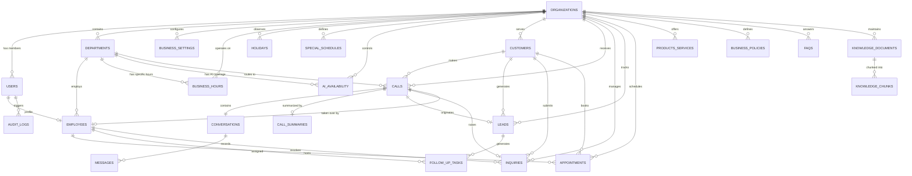

# FortiSales AI – Normalized Database Design & Data Architecture

## 1. Relational Database Overview & Design Principles

The database architecture for **FortiSales AI** is built on **PostgreSQL 16** with the `pgvector` and `btree_gist` extensions. It adheres to **Third Normal Form (3NF)** to eliminate redundancy, safeguard transactional integrity, and deliver predictable query performance under concurrent load.

### Key Architectural Tenets:
1. **Multi-Tenant Isolation**: Every operational tenant entity is explicitly bounded by `org_id` (UUID foreign key referencing `organizations.id`).
2. **Surrogate UUID Primary Keys**: Every primary entity uses UUIDv4 (`gen_random_uuid()`) to prevent enumeration attacks and simplify distributed replication.
3. **Auditability & Timestamp Tracking**: Operational records implement `created_at` and `updated_at` timestamps for non-destructive maintenance and compliance.
4. **Strong Constraints & Check Validations**: Database-level checks guarantee valid time ranges, enum statuses, sentiment classifications, and phone numbers.
5. **Conflict-Free Scheduling via GiST Exclusion**: Uses PostgreSQL `btree_gist` with an exclusion constraint (`no_overlapping_appointments`) to enforce zero overlapping calendar bookings for any employee at the storage engine level.
6. **Unified Relational & Vector Storage**: Document metadata, structured product catalogs, FAQs, and 384-dimensional dense vectors reside within the same atomic ACID boundary using `pgvector`.

---

## 2. Entity-Relationship Diagram (ERD)

---

## 3. Detailed Table Schema Specification

### 3.1 Organization & User Management

#### `organizations`
Represents the multi-tenant boundary.
- `id`: `UUID` (PK, default `gen_random_uuid()`)
- `name`: `VARCHAR(255)` NOT NULL
- `slug`: `VARCHAR(100)` NOT NULL UNIQUE (URL-safe identifier)
- `default_timezone`: `VARCHAR(50)` NOT NULL DEFAULT 'UTC'
- `is_active`: `BOOLEAN` NOT NULL DEFAULT true
- `created_at`: `TIMESTAMPTZ` NOT NULL DEFAULT clock_timestamp()
- `updated_at`: `TIMESTAMPTZ` NOT NULL DEFAULT clock_timestamp()

#### `users`
System user accounts across all roles.
- `id`: `UUID` (PK, default `gen_random_uuid()`)
- `org_id`: `UUID` NOT NULL (FK `organizations.id` ON DELETE CASCADE)
- `email`: `VARCHAR(255)` NOT NULL
- `password_hash`: `VARCHAR(255)` NOT NULL (Scrypt RFC 7914 hashed)
- `full_name`: `VARCHAR(255)` NOT NULL
- `role`: `VARCHAR(50)` NOT NULL DEFAULT 'sales_employee' (CHECK in `owner`, `admin`, `receptionist`, `sales_employee`, `employee`)
- `phone_number`: `VARCHAR(50)` NULL
- `is_active`: `BOOLEAN` NOT NULL DEFAULT true
- `created_at`: `TIMESTAMPTZ` NOT NULL DEFAULT clock_timestamp()
- `updated_at`: `TIMESTAMPTZ` NOT NULL DEFAULT clock_timestamp()
- *Constraints*: `UNIQUE(org_id, email)`

#### `departments`
Functional business divisions (Sales, Support, Billing).
- `id`: `UUID` (PK, default `gen_random_uuid()`)
- `org_id`: `UUID` NOT NULL (FK `organizations.id` ON DELETE CASCADE)
- `name`: `VARCHAR(100)` NOT NULL
- `slug`: `VARCHAR(100)` NOT NULL
- `description`: `TEXT` NULL
- `is_active`: `BOOLEAN` NOT NULL DEFAULT true
- *Constraints*: `UNIQUE(org_id, slug)`

#### `employees`
Staff operational profiles linked to system users.
- `id`: `UUID` (PK, default `gen_random_uuid()`)
- `org_id`: `UUID` NOT NULL (FK `organizations.id` ON DELETE CASCADE)
- `user_id`: `UUID` NOT NULL UNIQUE (FK `users.id` ON DELETE CASCADE)
- `department_id`: `UUID` NULL (FK `departments.id` ON DELETE SET NULL)
- `title`: `VARCHAR(100)` NULL
- `is_available_for_takeover`: `BOOLEAN` NOT NULL DEFAULT false
- `is_available_for_booking`: `BOOLEAN` NOT NULL DEFAULT true
- `created_at`: `TIMESTAMPTZ` NOT NULL DEFAULT clock_timestamp()
- `updated_at`: `TIMESTAMPTZ` NOT NULL DEFAULT clock_timestamp()

---

### 3.2 Business Configuration Subsystem

#### `business_settings`
Organization profile, description, contact coordinates, and after-hours behavior.
- `id`: `UUID` (PK, default `gen_random_uuid()`)
- `org_id`: `UUID` NOT NULL UNIQUE (FK `organizations.id` ON DELETE CASCADE)
- `business_description`: `TEXT` NULL
- `business_services`: `TEXT` NULL
- `industry`: `VARCHAR(100)` NULL
- `website`: `VARCHAR(255)` NULL
- `company_overview`: `TEXT` NULL
- `additional_info`: `TEXT` NULL
- `contact_phone`: `VARCHAR(50)` NULL
- `contact_email`: `VARCHAR(255)` NULL
- `business_address`: `TEXT` NULL
- `after_hours_behavior`: `VARCHAR(50)` NOT NULL DEFAULT 'ai_voicemail' (CHECK in `ai_receptionist`, `ai_voicemail`, `forward_to_phone`, `closed_message`)

#### `business_hours`
Weekly recurring schedule per weekday.
- `id`: `UUID` (PK, default `gen_random_uuid()`)
- `org_id`: `UUID` NOT NULL (FK `organizations.id` ON DELETE CASCADE)
- `department_id`: `UUID` NULL (FK `departments.id` ON DELETE CASCADE)
- `day_of_week`: `INTEGER` NOT NULL (CHECK 0=Sunday to 6=Saturday)
- `open_time`: `TIME` NOT NULL
- `close_time`: `TIME` NOT NULL
- `is_closed`: `BOOLEAN` NOT NULL DEFAULT false
- *Constraints*: `CHECK(open_time < close_time)`

#### `holidays`
Statutory and corporate holiday closures.
- `id`: `UUID` (PK, default `gen_random_uuid()`)
- `org_id`: `UUID` NOT NULL (FK `organizations.id` ON DELETE CASCADE)
- `name`: `VARCHAR(100)` NOT NULL
- `holiday_date`: `DATE` NOT NULL
- `is_recurring`: `BOOLEAN` NOT NULL DEFAULT false

#### `special_schedules`
Date-specific operational exceptions overriding weekly hours.
- `id`: `UUID` (PK, default `gen_random_uuid()`)
- `org_id`: `UUID` NOT NULL (FK `organizations.id` ON DELETE CASCADE)
- `specific_date`: `DATE` NOT NULL
- `open_time`: `TIME` NULL
- `close_time`: `TIME` NULL
- `is_closed`: `BOOLEAN` NOT NULL DEFAULT false
- `reason`: `VARCHAR(255)` NULL

---

### 3.3 Call & Conversational Voice Subsystem

#### `customers`
Caller identity records uniquely indexed per tenant.
- `id`: `UUID` (PK, default `gen_random_uuid()`)
- `org_id`: `UUID` NOT NULL (FK `organizations.id` ON DELETE CASCADE)
- `phone_number`: `VARCHAR(50)` NOT NULL
- `email`: `VARCHAR(255)` NULL
- `first_name`: `VARCHAR(100)` NULL
- `last_name`: `VARCHAR(100)` NULL
- `company_name`: `VARCHAR(150)` NULL
- `total_calls_count`: `INTEGER` NOT NULL DEFAULT 0
- `last_called_at`: `TIMESTAMPTZ` NULL
- `notes`: `TEXT` NULL
- `source`: `VARCHAR(100)` NULL DEFAULT 'inbound_call'
- `created_at`: `TIMESTAMPTZ` NOT NULL DEFAULT clock_timestamp()
- `updated_at`: `TIMESTAMPTZ` NOT NULL DEFAULT clock_timestamp()
- *Constraints*: `UNIQUE(org_id, phone_number)`

#### `calls`
Inbound/outbound call sessions.
- `id`: `UUID` (PK, default `gen_random_uuid()`)
- `org_id`: `UUID` NOT NULL (FK `organizations.id` ON DELETE CASCADE)
- `customer_id`: `UUID` NULL (FK `customers.id` ON DELETE SET NULL)
- `department_id`: `UUID` NULL (FK `departments.id` ON DELETE SET NULL)
- `taken_over_by_employee_id`: `UUID` NULL (FK `employees.id` ON DELETE SET NULL)
- `telephony_call_sid`: `VARCHAR(100)` NULL UNIQUE
- `caller_phone_number`: `VARCHAR(50)` NOT NULL
- `callee_phone_number`: `VARCHAR(50)` NOT NULL
- `status`: `VARCHAR(50)` NOT NULL DEFAULT 'initiated' (CHECK in `initiated`, `in_progress`, `completed`, `handed_off`, `dropped`, `failed`)
- `started_at`: `TIMESTAMPTZ` NOT NULL DEFAULT clock_timestamp()
- `ended_at`: `TIMESTAMPTZ` NULL
- `duration_seconds`: `INTEGER` NULL
- `recording_url`: `VARCHAR(1024)` NULL
- `recording_consent_given`: `BOOLEAN` NOT NULL DEFAULT true
- `sentiment_overall`: `VARCHAR(50)` NULL
- `outcome`: `VARCHAR(100)` NULL
- `notes`: `TEXT` NULL
- `created_at`: `TIMESTAMPTZ` NOT NULL DEFAULT clock_timestamp()

#### `conversations`
Dialogue session associated with a call.
- `id`: `UUID` (PK, default `gen_random_uuid()`)
- `org_id`: `UUID` NOT NULL (FK `organizations.id` ON DELETE CASCADE)
- `call_id`: `UUID` NULL UNIQUE (FK `calls.id` ON DELETE CASCADE)
- `status`: `VARCHAR(50)` NOT NULL DEFAULT 'active' (CHECK in `active`, `completed`, `handed_off`, `abandoned`)
- `summary`: `TEXT` NULL
- `language`: `VARCHAR(10)` NOT NULL DEFAULT 'en'
- `turn_count`: `INTEGER` NOT NULL DEFAULT 0
- `created_at`: `TIMESTAMPTZ` NOT NULL DEFAULT clock_timestamp()

#### `messages`
Individual speaker turns in a conversation.
- `id`: `UUID` (PK, default `gen_random_uuid()`)
- `conversation_id`: `UUID` NOT NULL (FK `conversations.id` ON DELETE CASCADE)
- `turn_number`: `INTEGER` NOT NULL
- `speaker_role`: `VARCHAR(30)` NOT NULL (CHECK in `caller`, `ai_agent`, `human_agent`, `system`)
- `content`: `TEXT` NOT NULL
- `sentiment`: `VARCHAR(30)` NULL
- `confidence_score`: `NUMERIC(4,3)` NULL
- `latency_ms`: `INTEGER` NULL
- `created_at`: `TIMESTAMPTZ` NOT NULL DEFAULT clock_timestamp()
- *Constraints*: `UNIQUE(conversation_id, turn_number)`

#### `call_summaries`
Post-call analytical summary.
- `id`: `UUID` (PK, default `gen_random_uuid()`)
- `call_id`: `UUID` NOT NULL UNIQUE (FK `calls.id` ON DELETE CASCADE)
- `primary_intent`: `VARCHAR(100)` NOT NULL
- `executive_summary`: `TEXT` NOT NULL
- `key_points_discussed`: `JSONB` NOT NULL DEFAULT '[]'::jsonb
- `customer_objections`: `JSONB` NOT NULL DEFAULT '[]'::jsonb
- `action_items`: `JSONB` NOT NULL DEFAULT '[]'::jsonb
- `lead_qualification_summary`: `TEXT` NULL
- `follow_up_recommended`: `BOOLEAN` NOT NULL DEFAULT false
- `created_at`: `TIMESTAMPTZ` NOT NULL DEFAULT clock_timestamp()

---

### 3.4 CRM, Appointments & Escalations Subsystem

#### `leads`
Sales opportunities qualified from conversation turns.
- `id`: `UUID` (PK, default `gen_random_uuid()`)
- `org_id`: `UUID` NOT NULL (FK `organizations.id` ON DELETE CASCADE)
- `customer_id`: `UUID` NOT NULL (FK `customers.id` ON DELETE CASCADE)
- `originating_call_id`: `UUID` NULL UNIQUE (FK `calls.id` ON DELETE SET NULL)
- `score`: `INTEGER` NOT NULL DEFAULT 0 (CHECK between 0 and 100)
- `status`: `VARCHAR(50)` NOT NULL DEFAULT 'new' (CHECK in `new`, `contacted`, `qualified`, `unqualified`, `converted`, `lost`)
- `qualification_tier`: `VARCHAR(20)` NOT NULL DEFAULT 'cold' (CHECK in `cold`, `warm`, `hot`)
- `budget_range`: `VARCHAR(100)` NULL
- `decision_timeline`: `VARCHAR(100)` NULL
- `authority_confirmed`: `BOOLEAN` NOT NULL DEFAULT false
- `extracted_needs`: `TEXT` NULL
- `assigned_employee_id`: `UUID` NULL (FK `employees.id` ON DELETE SET NULL)
- `title`: `VARCHAR(255)` NULL
- `notes`: `TEXT` NULL
- `priority`: `VARCHAR(20)` NULL DEFAULT 'medium'
- `qualification_notes`: `TEXT` NULL
- `created_at`: `TIMESTAMPTZ` NOT NULL DEFAULT clock_timestamp()
- `updated_at`: `TIMESTAMPTZ` NOT NULL DEFAULT clock_timestamp()

#### `inquiries`
Customer support and sales inquiry tickets.
- `id`: `UUID` (PK, default `gen_random_uuid()`)
- `org_id`: `UUID` NOT NULL (FK `organizations.id` ON DELETE CASCADE)
- `customer_id`: `UUID` NOT NULL (FK `customers.id` ON DELETE CASCADE)
- `originating_call_id`: `UUID` NULL (FK `calls.id` ON DELETE SET NULL)
- `assigned_employee_id`: `UUID` NULL (FK `employees.id` ON DELETE SET NULL)
- `subject`: `VARCHAR(255)` NOT NULL
- `description`: `TEXT` NULL
- `status`: `VARCHAR(50)` NOT NULL DEFAULT 'open' (CHECK in `open`, `in_progress`, `resolved`, `closed`)
- `priority`: `VARCHAR(20)` NOT NULL DEFAULT 'medium' (CHECK in `low`, `medium`, `high`, `urgent`)
- `resolution_notes`: `TEXT` NULL
- `resolved_at`: `TIMESTAMPTZ` NULL
- `created_at`: `TIMESTAMPTZ` NOT NULL DEFAULT clock_timestamp()
- `updated_at`: `TIMESTAMPTZ` NOT NULL DEFAULT clock_timestamp()

#### `appointments`
Scheduled calendar meetings protected by GiST exclusion constraints.
- `id`: `UUID` (PK, default `gen_random_uuid()`)
- `org_id`: `UUID` NOT NULL (FK `organizations.id` ON DELETE CASCADE)
- `customer_id`: `UUID` NOT NULL (FK `customers.id` ON DELETE CASCADE)
- `employee_id`: `UUID` NOT NULL (FK `employees.id` ON DELETE CASCADE)
- `originating_call_id`: `UUID` NULL (FK `calls.id` ON DELETE SET NULL)
- `title`: `VARCHAR(255)` NOT NULL
- `start_time`: `TIMESTAMPTZ` NOT NULL
- `end_time`: `TIMESTAMPTZ` NOT NULL
- `status`: `VARCHAR(50)` NOT NULL DEFAULT 'scheduled' (CHECK in `scheduled`, `confirmed`, `completed`, `cancelled`, `no_show`)
- `meeting_type`: `VARCHAR(100)` NOT NULL DEFAULT 'Sales Discovery Call'
- `purpose`: `TEXT` NULL
- `meeting_link_or_phone`: `VARCHAR(255)` NULL
- `calendar_event_id`: `VARCHAR(255)` NULL
- `booking_source`: `VARCHAR(50)` NOT NULL DEFAULT 'ai_receptionist'
- `notes`: `TEXT` NULL
- `cancellation_reason`: `TEXT` NULL
- `rescheduled_from_id`: `UUID` NULL (Self-referencing FK `appointments.id`)
- `created_at`: `TIMESTAMPTZ` NOT NULL DEFAULT clock_timestamp()
- `updated_at`: `TIMESTAMPTZ` NOT NULL DEFAULT clock_timestamp()
- *Constraints*:
  - `CHECK(start_time < end_time)`
  - **GiST Exclusion Constraint**: `no_overlapping_appointments` on `(employee_id WITH =, tstzrange(start_time, end_time, '[)') WITH &&)` where `status IN ('scheduled', 'confirmed')`.

#### `follow_up_tasks`
Tasks assigned to employees.
- `id`: `UUID` (PK, default `gen_random_uuid()`)
- `org_id`: `UUID` NOT NULL (FK `organizations.id` ON DELETE CASCADE)
- `lead_id`: `UUID` NULL (FK `leads.id` ON DELETE CASCADE)
- `assigned_employee_id`: `UUID` NOT NULL (FK `employees.id` ON DELETE CASCADE)
- `title`: `VARCHAR(255)` NOT NULL
- `description`: `TEXT` NULL
- `priority`: `VARCHAR(20)` NOT NULL DEFAULT 'medium' (CHECK in `low`, `medium`, `high`, `urgent`)
- `due_date`: `TIMESTAMPTZ` NOT NULL
- `is_completed`: `BOOLEAN` NOT NULL DEFAULT false
- `completed_at`: `TIMESTAMPTZ` NULL
- `created_at`: `TIMESTAMPTZ` NOT NULL DEFAULT clock_timestamp()

---

### 3.5 Knowledge Base & RAG Subsystem

#### `products_services`
Structured catalog offerings with definitive pricing.
- `id`: `UUID` (PK, default `gen_random_uuid()`)
- `org_id`: `UUID` NOT NULL (FK `organizations.id` ON DELETE CASCADE)
- `name`: `VARCHAR(255)` NOT NULL
- `category`: `VARCHAR(100)` NOT NULL
- `description`: `TEXT` NULL
- `pricing_model`: `VARCHAR(50)` NOT NULL DEFAULT 'fixed' (CHECK in `fixed`, `starting_at`, `quote_required`, `hourly`, `tier_based`)
- `base_price`: `NUMERIC(12,2)` NULL
- `currency`: `VARCHAR(10)` NOT NULL DEFAULT 'USD'
- `unit`: `VARCHAR(50)` NULL
- `is_active`: `BOOLEAN` NOT NULL DEFAULT true

#### `business_policies`
Corporate rules and terms (returns, SLAs, terms of service).
- `id`: `UUID` (PK, default `gen_random_uuid()`)
- `org_id`: `UUID` NOT NULL (FK `organizations.id` ON DELETE CASCADE)
- `policy_name`: `VARCHAR(255)` NOT NULL
- `policy_category`: `VARCHAR(100)` NOT NULL DEFAULT 'general'
- `summary`: `TEXT` NOT NULL
- `full_text`: `TEXT` NULL
- `is_active`: `BOOLEAN` NOT NULL DEFAULT true

#### `faqs`
Frequently asked questions and verified answers.
- `id`: `UUID` (PK, default `gen_random_uuid()`)
- `org_id`: `UUID` NOT NULL (FK `organizations.id` ON DELETE CASCADE)
- `question`: `TEXT` NOT NULL
- `answer`: `TEXT` NOT NULL
- `category`: `VARCHAR(100)` NOT NULL DEFAULT 'general'
- `is_active`: `BOOLEAN` NOT NULL DEFAULT true

#### `knowledge_documents`
Uploaded documentation files.
- `id`: `UUID` (PK, default `gen_random_uuid()`)
- `org_id`: `UUID` NOT NULL (FK `organizations.id` ON DELETE CASCADE)
- `title`: `VARCHAR(255)` NOT NULL
- `document_type`: `VARCHAR(50)` NOT NULL DEFAULT 'general' (CHECK in `faq`, `product_spec`, `policy`, `pricing`, `general`)
- `file_path`: `VARCHAR(1024)` NULL
- `file_size_bytes`: `INTEGER` NULL
- `mime_type`: `VARCHAR(100)` NOT NULL DEFAULT 'text/plain'
- `raw_content`: `TEXT` NULL
- `status`: `VARCHAR(50)` NOT NULL DEFAULT 'pending' (CHECK in `pending`, `processing`, `processed`, `failed`)
- `created_at`: `TIMESTAMPTZ` NOT NULL DEFAULT clock_timestamp()

#### `knowledge_chunks`
Vector chunks embedded for semantic retrieval.
- `id`: `UUID` (PK, default `gen_random_uuid()`)
- `org_id`: `UUID` NOT NULL (FK `organizations.id` ON DELETE CASCADE)
- `document_id`: `UUID` NOT NULL (FK `knowledge_documents.id` ON DELETE CASCADE)
- `chunk_index`: `INTEGER` NOT NULL
- `content`: `TEXT` NOT NULL
- `token_count`: `INTEGER` NOT NULL DEFAULT 0
- `embedding`: `Vector(384)` NOT NULL
- `metadata_json`: `JSONB` NOT NULL DEFAULT '{}'::jsonb
- `created_at`: `TIMESTAMPTZ` NOT NULL DEFAULT clock_timestamp()
- *Indexes*: Cosine vector distance index (`HNSW` / IVFFlat on `embedding vector_cosine_ops`)
