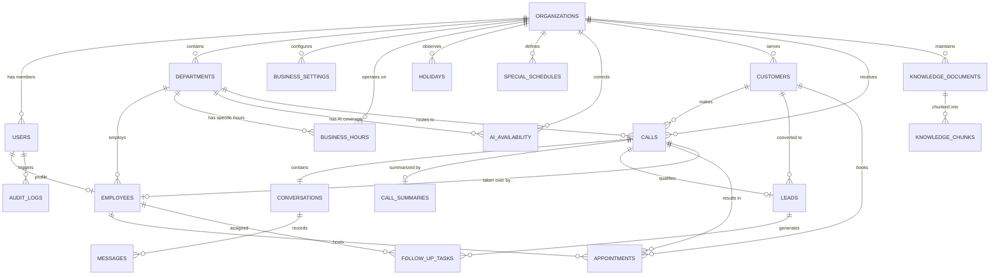

# FortiSales AI – Normalized Database Design & Data Architecture

## 1. Relational Database Overview & Design Principles

The database architecture for **FortiSales AI** is built on **PostgreSQL 16** with the `pgvector` and `uuid-ossp` extensions. It adheres to **Third Normal Form (3NF)** to eliminate redundancy, safeguard transactional integrity, and deliver predictable query performance under concurrent load.

### Key Architectural Tenets:
1. **Multi-Tenant Isolation**: Every tenant entity is explicitly bounded by `org_id` (UUID foreign key referencing `organizations.id`).
2. **Surrogate UUID Primary Keys**: Every primary entity uses UUIDv4 (`gen_random_uuid()`) to prevent enumeration attacks and simplify distributed replication.
3. **Auditability & Soft Deletes**: Core operational records implement `created_at`, `updated_at`, and `deleted_at` timestamps for non-destructive maintenance and compliance.
4. **Strong Constraints & Check Validations**: Database-level checks guarantee valid time ranges, enum values, and phone numbers.
5. **Conflict-Free Scheduling**: Exclusion constraints and unique indexing prevent double-booking of appointments across employees.

---

## 2. Entity-Relationship Diagram (ERD)



---

## 3. Detailed Table Schema Specification

### 3.1 Organization & User Management

#### `organizations`
Represents the tenant boundary.
- `id`: `UUID` (PK, default `gen_random_uuid()`)
- `name`: `VARCHAR(255)` NOT NULL
- `slug`: `VARCHAR(100)` NOT NULL UNIQUE (URL safe identifier)
- `default_timezone`: `VARCHAR(50)` NOT NULL DEFAULT 'UTC'
- `is_active`: `BOOLEAN` NOT NULL DEFAULT true
- `created_at`: `TIMESTAMPTZ` NOT NULL DEFAULT clock_timestamp()
- `updated_at`: `TIMESTAMPTZ` NOT NULL DEFAULT clock_timestamp()
- `deleted_at`: `TIMESTAMPTZ` NULL

#### `users`
System user accounts across all roles.
- `id`: `UUID` (PK, default `gen_random_uuid()`)
- `org_id`: `UUID` NOT NULL (FK `organizations.id` ON DELETE CASCADE)
- `email`: `VARCHAR(255)` NOT NULL
- `password_hash`: `VARCHAR(255)` NOT NULL
- `full_name`: `VARCHAR(255)` NOT NULL
- `role`: `VARCHAR(50)` NOT NULL (CHECK in `super_admin`, `admin`, `receptionist`, `sales_employee`, `ai_agent`)
- `phone_number`: `VARCHAR(50)` NULL
- `is_active`: `BOOLEAN` NOT NULL DEFAULT true
- `last_login_at`: `TIMESTAMPTZ` NULL
- `created_at`: `TIMESTAMPTZ` NOT NULL DEFAULT clock_timestamp()
- `updated_at`: `TIMESTAMPTZ` NOT NULL DEFAULT clock_timestamp()
- *Constraints*: `UNIQUE(org_id, email)`

#### `departments`
Organizational business units (e.g., Enterprise Sales, Product Support).
- `id`: `UUID` (PK, default `gen_random_uuid()`)
- `org_id`: `UUID` NOT NULL (FK `organizations.id` ON DELETE CASCADE)
- `name`: `VARCHAR(100)` NOT NULL
- `description`: `TEXT` NULL
- `fallback_phone`: `VARCHAR(50)` NULL (for external PSTN call forwarding)
- `created_at`: `TIMESTAMPTZ` NOT NULL DEFAULT clock_timestamp()
- `updated_at`: `TIMESTAMPTZ` NOT NULL DEFAULT clock_timestamp()
- *Constraints*: `UNIQUE(org_id, name)`

#### `employees`
Staff profiles linked to users and departments.
- `id`: `UUID` (PK, default `gen_random_uuid()`)
- `org_id`: `UUID` NOT NULL (FK `organizations.id` ON DELETE CASCADE)
- `user_id`: `UUID` NOT NULL UNIQUE (FK `users.id` ON DELETE CASCADE)
- `department_id`: `UUID` NULL (FK `departments.id` ON DELETE SET NULL)
- `title`: `VARCHAR(100)` NULL
- `calendar_sync_email`: `VARCHAR(255)` NULL (Google Calendar / Outlook integration)
- `appointment_slot_duration_minutes`: `INTEGER` NOT NULL DEFAULT 30
- `is_available_for_takeover`: `BOOLEAN` NOT NULL DEFAULT false
- `is_available_for_booking`: `BOOLEAN` NOT NULL DEFAULT true
- `created_at`: `TIMESTAMPTZ` NOT NULL DEFAULT clock_timestamp()
- `updated_at`: `TIMESTAMPTZ` NOT NULL DEFAULT clock_timestamp()

---

### 3.2 Business Availability & Operations Configuration

#### `business_settings`
Global organizational receptionist operational flags, business profile, and AI defaults.
- `id`: `UUID` (PK, default `gen_random_uuid()`)
- `org_id`: `UUID` NOT NULL UNIQUE (FK `organizations.id` ON DELETE CASCADE)
- `primary_language`: `VARCHAR(10)` NOT NULL DEFAULT 'en'
- `enable_multilingual`: `BOOLEAN` NOT NULL DEFAULT true
- `voice_id`: `VARCHAR(100)` NOT NULL DEFAULT 'sonic-english-1'
- `after_hours_behavior`: `VARCHAR(50)` NOT NULL DEFAULT 'ai_voicemail' (CHECK in `ai_voicemail`, `forward_to_number`, `ai_general_info_only`, `reject`)
- `holiday_behavior`: `VARCHAR(50)` NOT NULL DEFAULT 'holiday_greeting'
- `max_call_duration_seconds`: `INTEGER` NOT NULL DEFAULT 900 (15 minutes)
- `recording_consent_required`: `BOOLEAN` NOT NULL DEFAULT true
- `contact_phone`: `VARCHAR(50)` NULL
- `contact_email`: `VARCHAR(255)` NULL
- `business_address`: `TEXT` NULL
- `business_description`: `TEXT` NULL
- `business_services`: `TEXT` NULL
- `created_at`: `TIMESTAMPTZ` NOT NULL DEFAULT clock_timestamp()
- `updated_at`: `TIMESTAMPTZ` NOT NULL DEFAULT clock_timestamp()

#### `business_hours`
Weekly operating schedule per organization or specific department.
- `id`: `UUID` (PK, default `gen_random_uuid()`)
- `org_id`: `UUID` NOT NULL (FK `organizations.id` ON DELETE CASCADE)
- `department_id`: `UUID` NULL (FK `departments.id` ON DELETE CASCADE, NULL = org default)
- `day_of_week`: `SMALLINT` NOT NULL (CHECK between 0 [Sunday] and 6 [Saturday])
- `open_time`: `TIME` NOT NULL
- `close_time`: `TIME` NOT NULL
- `is_closed`: `BOOLEAN` NOT NULL DEFAULT false
- `created_at`: `TIMESTAMPTZ` NOT NULL DEFAULT clock_timestamp()
- *Constraints*: `CHECK(open_time < close_time)`, `UNIQUE(org_id, department_id, day_of_week, open_time)`

#### `holidays`
Official holidays when standard hours are superseded.
- `id`: `UUID` (PK, default `gen_random_uuid()`)
- `org_id`: `UUID` NOT NULL (FK `organizations.id` ON DELETE CASCADE)
- `name`: `VARCHAR(150)` NOT NULL
- `start_date`: `DATE` NOT NULL
- `end_date`: `DATE` NOT NULL
- `is_recurring_yearly`: `BOOLEAN` NOT NULL DEFAULT false
- `special_announcement`: `TEXT` NULL (Custom message spoken by AI on this holiday)
- `created_at`: `TIMESTAMPTZ` NOT NULL DEFAULT clock_timestamp()
- *Constraints*: `CHECK(start_date <= end_date)`

#### `special_schedules`
Overrides for specific dates (e.g., temporary early closures, special working Saturdays).
- `id`: `UUID` (PK, default `gen_random_uuid()`)
- `org_id`: `UUID` NOT NULL (FK `organizations.id` ON DELETE CASCADE)
- `department_id`: `UUID` NULL (FK `departments.id` ON DELETE CASCADE)
- `schedule_date`: `DATE` NOT NULL
- `open_time`: `TIME` NULL
- `close_time`: `TIME` NULL
- `is_closed_all_day`: `BOOLEAN` NOT NULL DEFAULT false
- `reason`: `VARCHAR(255)` NULL
- `created_at`: `TIMESTAMPTZ` NOT NULL DEFAULT clock_timestamp()
- *Constraints*: `UNIQUE(org_id, department_id, schedule_date)`

#### `ai_availability`
Real-time state and operational overrides for the AI receptionist.
- `id`: `UUID` (PK, default `gen_random_uuid()`)
- `org_id`: `UUID` NOT NULL (FK `organizations.id` ON DELETE CASCADE)
- `department_id`: `UUID` NULL (FK `departments.id` ON DELETE CASCADE)
- `status`: `VARCHAR(50)` NOT NULL DEFAULT 'online' (CHECK in `online`, `offline`, `maintenance`, `takeover_only`)
- `auto_schedule_enabled`: `BOOLEAN` NOT NULL DEFAULT true
- `emergency_closure_active`: `BOOLEAN` NOT NULL DEFAULT false
- `emergency_reason`: `TEXT` NULL
- `temp_offline_until`: `TIMESTAMPTZ` NULL
- `scheduled_status`: `VARCHAR(50)` NULL
- `scheduled_status_change_at`: `TIMESTAMPTZ` NULL
- `last_status_change_at`: `TIMESTAMPTZ` NOT NULL DEFAULT clock_timestamp()
- `changed_by_user_id`: `UUID` NULL (FK `users.id` ON DELETE SET NULL)
- *Constraints*: `UNIQUE(org_id, department_id)`

---

### 3.3 Customer & Communication Subsystem

#### `customers`
Contact records for individuals interacting with the business.
- `id`: `UUID` (PK, default `gen_random_uuid()`)
- `org_id`: `UUID` NOT NULL (FK `organizations.id` ON DELETE CASCADE)
- `phone_number`: `VARCHAR(50)` NOT NULL
- `email`: `VARCHAR(255)` NULL
- `first_name`: `VARCHAR(100)` NULL
- `last_name`: `VARCHAR(100)` NULL
- `company_name`: `VARCHAR(150)` NULL
- `total_calls_count`: `INTEGER` NOT NULL DEFAULT 0
- `last_called_at`: `TIMESTAMPTZ` NULL
- `created_at`: `TIMESTAMPTZ` NOT NULL DEFAULT clock_timestamp()
- `updated_at`: `TIMESTAMPTZ` NOT NULL DEFAULT clock_timestamp()
- *Constraints*: `UNIQUE(org_id, phone_number)`

#### `calls`
Individual call sessions.
- `id`: `UUID` (PK, default `gen_random_uuid()`)
- `org_id`: `UUID` NOT NULL (FK `organizations.id` ON DELETE CASCADE)
- `customer_id`: `UUID` NULL (FK `customers.id` ON DELETE SET NULL)
- `department_id`: `UUID` NULL (FK `departments.id` ON DELETE SET NULL)
- `taken_over_by_employee_id`: `UUID` NULL (FK `employees.id` ON DELETE SET NULL)
- `telephony_call_sid`: `VARCHAR(100)` NULL UNIQUE (e.g., Twilio Call SID)
- `caller_phone_number`: `VARCHAR(50)` NOT NULL
- `callee_phone_number`: `VARCHAR(50)` NOT NULL
- `status`: `VARCHAR(50)` NOT NULL DEFAULT 'initiated' (CHECK in `initiated`, `in_progress`, `completed`, `handed_off`, `dropped`, `failed`)
- `started_at`: `TIMESTAMPTZ` NOT NULL DEFAULT clock_timestamp()
- `ended_at`: `TIMESTAMPTZ` NULL
- `duration_seconds`: `INTEGER` NULL
- `recording_url`: `VARCHAR(1024)` NULL
- `recording_consent_given`: `BOOLEAN` NOT NULL DEFAULT true
- `sentiment_overall`: `VARCHAR(50)` NULL (CHECK in `positive`, `neutral`, `negative`, `frustrated`)
- `created_at`: `TIMESTAMPTZ` NOT NULL DEFAULT clock_timestamp()

#### `conversations`
The dialog session associated with a call.
- `id`: `UUID` (PK, default `gen_random_uuid()`)
- `call_id`: `UUID` NOT NULL UNIQUE (FK `calls.id` ON DELETE CASCADE)
- `language`: `VARCHAR(10)` NOT NULL DEFAULT 'en'
- `turn_count`: `INTEGER` NOT NULL DEFAULT 0
- `created_at`: `TIMESTAMPTZ` NOT NULL DEFAULT clock_timestamp()

#### `messages`
Individual speaker turns in a conversation.
- `id`: `UUID` (PK, default `gen_random_uuid()`)
- `conversation_id`: `UUID` NOT NULL (FK `conversations.id` ON DELETE CASCADE)
- `turn_number`: `INTEGER` NOT NULL
- `speaker_role`: `VARCHAR(30)` NOT NULL (CHECK in `caller`, `ai_agent`, `human_agent`, `system`)
- `content`: `TEXT` NOT NULL
- `sentiment`: `VARCHAR(30)` NULL
- `confidence_score`: `NUMERIC(4,3)` NULL
- `latency_ms`: `INTEGER` NULL
- `created_at`: `TIMESTAMPTZ` NOT NULL DEFAULT clock_timestamp()
- *Constraints*: `UNIQUE(conversation_id, turn_number)`

#### `call_summaries`
Post-call structured analytical summary generated by the LLM.
- `id`: `UUID` (PK, default `gen_random_uuid()`)
- `call_id`: `UUID` NOT NULL UNIQUE (FK `calls.id` ON DELETE CASCADE)
- `primary_intent`: `VARCHAR(100)` NOT NULL
- `executive_summary`: `TEXT` NOT NULL
- `key_points_discussed`: `JSONB` NOT NULL DEFAULT '[]'::jsonb
- `customer_objections`: `JSONB` NOT NULL DEFAULT '[]'::jsonb
- `action_items`: `JSONB` NOT NULL DEFAULT '[]'::jsonb
- `lead_qualification_summary`: `TEXT` NULL
- `follow_up_recommended`: `BOOLEAN` NOT NULL DEFAULT false
- `created_at`: `TIMESTAMPTZ` NOT NULL DEFAULT clock_timestamp()

---

### 3.4 CRM, Sales & Knowledge Subsystem

#### `leads`
Qualified prospective business opportunities extracted from calls.
- `id`: `UUID` (PK, default `gen_random_uuid()`)
- `org_id`: `UUID` NOT NULL (FK `organizations.id` ON DELETE CASCADE)
- `customer_id`: `UUID` NOT NULL (FK `customers.id` ON DELETE CASCADE)
- `originating_call_id`: `UUID` NULL (FK `calls.id` ON DELETE SET NULL)
- `score`: `INTEGER` NOT NULL DEFAULT 0 (CHECK between 0 and 100)
- `status`: `VARCHAR(50)` NOT NULL DEFAULT 'new' (CHECK in `new`, `contacted`, `qualified`, `unqualified`, `converted`, `lost`)
- `qualification_tier`: `VARCHAR(20)` NOT NULL DEFAULT 'cold' (CHECK in `cold`, `warm`, `hot`)
- `budget_range`: `VARCHAR(100)` NULL
- `decision_timeline`: `VARCHAR(100)` NULL
- `authority_confirmed`: `BOOLEAN` NOT NULL DEFAULT false
- `extracted_needs`: `TEXT` NULL
- `assigned_employee_id`: `UUID` NULL (FK `employees.id` ON DELETE SET NULL)
- `created_at`: `TIMESTAMPTZ` NOT NULL DEFAULT clock_timestamp()
- `updated_at`: `TIMESTAMPTZ` NOT NULL DEFAULT clock_timestamp()

#### `appointments`
Booked calendar meetings.
- `id`: `UUID` (PK, default `gen_random_uuid()`)
- `org_id`: `UUID` NOT NULL (FK `organizations.id` ON DELETE CASCADE)
- `customer_id`: `UUID` NOT NULL (FK `customers.id` ON DELETE CASCADE)
- `employee_id`: `UUID` NOT NULL (FK `employees.id` ON DELETE CASCADE)
- `originating_call_id`: `UUID` NULL (FK `calls.id` ON DELETE SET NULL)
- `start_time`: `TIMESTAMPTZ` NOT NULL
- `end_time`: `TIMESTAMPTZ` NOT NULL
- `status`: `VARCHAR(50)` NOT NULL DEFAULT 'scheduled' (CHECK in `scheduled`, `confirmed`, `completed`, `cancelled`, `no_show`)
- `meeting_type`: `VARCHAR(100)` NOT NULL DEFAULT 'Sales Discovery Call'
- `meeting_link_or_phone`: `VARCHAR(255)` NULL
- `calendar_event_id`: `VARCHAR(255)` NULL
- `notes`: `TEXT` NULL
- `created_at`: `TIMESTAMPTZ` NOT NULL DEFAULT clock_timestamp()
- `updated_at`: `TIMESTAMPTZ` NOT NULL DEFAULT clock_timestamp()
- *Constraints*: `CHECK(start_time < end_time)`

#### `follow_up_tasks`
Action items generated for human staff following a call or lead event.
- `id`: `UUID` (PK, default `gen_random_uuid()`)
- `org_id`: `UUID` NOT NULL (FK `organizations.id` ON DELETE CASCADE)
- `lead_id`: `UUID` NULL (FK `leads.id` ON DELETE CASCADE)
- `assigned_employee_id`: `UUID` NOT NULL (FK `employees.id` ON DELETE CASCADE)
- `title`: `VARCHAR(255)` NOT NULL
- `description`: `TEXT` NULL
- `priority`: `VARCHAR(20)` NOT NULL DEFAULT 'medium' (CHECK in `low`, `medium`, `high`, `urgent`)
- `due_date`: `TIMESTAMPTZ` NOT NULL
- `is_completed`: `BOOLEAN` NOT NULL DEFAULT false
- `completed_at`: `TIMESTAMPTZ` NULL
- `created_at`: `TIMESTAMPTZ` NOT NULL DEFAULT clock_timestamp()

#### `knowledge_documents`
Source knowledge documents for RAG.
- `id`: `UUID` (PK, default `gen_random_uuid()`)
- `org_id`: `UUID` NOT NULL (FK `organizations.id` ON DELETE CASCADE)
- `department_id`: `UUID` NULL (FK `departments.id` ON DELETE SET NULL)
- `title`: `VARCHAR(255)` NOT NULL
- `document_type`: `VARCHAR(50)` NOT NULL (CHECK in `faq`, `product_spec`, `pricing`, `policy`, `general`)
- `file_path`: `VARCHAR(1024)` NULL
- `content_hash`: `VARCHAR(64)` NOT NULL
- `chunk_count`: `INTEGER` NOT NULL DEFAULT 0
- `is_active`: `BOOLEAN` NOT NULL DEFAULT true
- `created_at`: `TIMESTAMPTZ` NOT NULL DEFAULT clock_timestamp()
- `updated_at`: `TIMESTAMPTZ` NOT NULL DEFAULT clock_timestamp()

#### `knowledge_chunks`
Vectorized semantic passages used during call RAG retrieval.
- `id`: `UUID` (PK, default `gen_random_uuid()`)
- `document_id`: `UUID` NOT NULL (FK `knowledge_documents.id` ON DELETE CASCADE)
- `org_id`: `UUID` NOT NULL (FK `organizations.id` ON DELETE CASCADE)
- `chunk_index`: `INTEGER` NOT NULL
- `chunk_content`: `TEXT` NOT NULL
- `embedding`: `vector(384)` NOT NULL (or `vector(1536)` depending on embedding model)
- `token_count`: `INTEGER` NOT NULL
- `created_at`: `TIMESTAMPTZ` NOT NULL DEFAULT clock_timestamp()

#### `audit_logs`
Immutable compliance and security audit trails.
- `id`: `UUID` (PK, default `gen_random_uuid()`)
- `org_id`: `UUID` NOT NULL (FK `organizations.id` ON DELETE CASCADE)
- `user_id`: `UUID` NULL (FK `users.id` ON DELETE SET NULL)
- `action`: `VARCHAR(100)` NOT NULL (e.g., `user.login`, `call.takeover`, `schedule.updated`, `doc.uploaded`)
- `entity_type`: `VARCHAR(50)` NOT NULL
- `entity_id`: `UUID` NULL
- `ip_address`: `VARCHAR(45)` NULL
- `user_agent`: `VARCHAR(255)` NULL
- `payload_diff`: `JSONB` NULL (before/after state changes)
- `created_at`: `TIMESTAMPTZ` NOT NULL DEFAULT clock_timestamp()

---

## 4. Performance Indexing Strategy

To guarantee rapid queries across 100,000+ registered users and millions of historical messages:

1. **Foreign Key Indexes**: Every foreign key column has an explicit B-tree index.
2. **Customer Lookup**: `CREATE INDEX idx_customers_org_phone ON customers(org_id, phone_number);`
3. **Active Call Monitoring**: `CREATE INDEX idx_calls_active ON calls(org_id, status) WHERE status IN ('initiated', 'in_progress');`
4. **Appointment Availability & Collision Prevention**:
   - `CREATE INDEX idx_appointments_emp_time ON appointments(employee_id, start_time, end_time) WHERE status != 'cancelled';`
   - Double-booking prevention via PostgreSQL GiST exclusion constraint:
     ```sql
     ALTER TABLE appointments ADD CONSTRAINT no_overlapping_appointments
     EXCLUDE USING gist (
       employee_id WITH =,
       tstzrange(start_time, end_time) WITH &&
     ) WHERE (status NOT IN ('cancelled', 'no_show'));
     ```
5. **RAG Vector Search Index**:
   - HNSW index on embeddings with cosine similarity:
     ```sql
     CREATE INDEX idx_knowledge_chunks_embedding ON knowledge_chunks
     USING hnsw (embedding vector_cosine_ops)
     WITH (m = 16, ef_construction = 64);
     ```
6. **Audit Trail Range Queries**: `CREATE INDEX idx_audit_org_created ON audit_logs(org_id, created_at DESC);`
