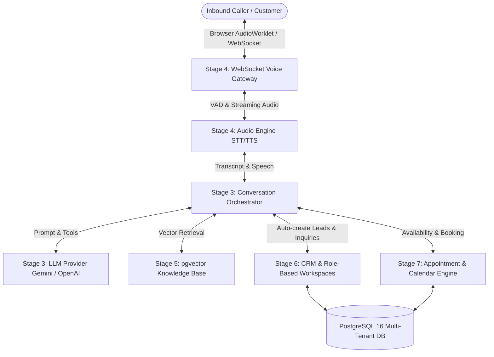
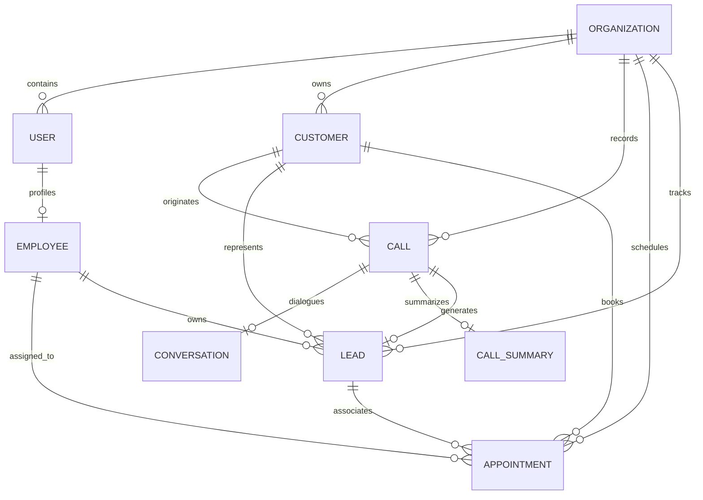

# FortiSales AI — Technical Implementation Handover & Presentation Guide

## 1. Executive System Overview
FortiSales AI is a production-grade, multi-tenant autonomous AI sales voice receptionist and CRM platform. Built with FastAPI, PostgreSQL 16 (with `pgvector` and `btree_gist`), SQLAlchemy ORM, Alembic migrations, Deepgram STT, Cartesia/ElevenLabs TTS, and Silero VAD, it serves businesses by autonomously answering inbound calls, answering questions from a verified company knowledge base (RAG), qualifying sales leads, and scheduling conflict-free discovery appointments directly into the calendar.

---

## 2. Architecture & Stage Summary



### Stage Implementations
- **Stage 1: Backend and Database Foundation**: Multi-tenant isolation hooks, PostgreSQL schema, JWT authentication, configuration management.
- **Stage 2: Authentication and Business Configuration**: RBAC hierarchy (`owner` > `super_admin` > `admin` > `receptionist` > `sales_employee`), business operating hours, holiday closures, special date schedules, and AI availability precedence resolution.
- **Stage 3: AI Conversation Engine**: Multi-turn `ConversationOrchestrator`, extensible `ToolRegistry`, prompt management with guardrails, token tracking, audit logging.
- **Stage 4: Real-Time Voice Engine**: Ephemeral single-use 256-bit tickets (`POST /voice/tickets`), WebSocket audio gateway with PCM16 streaming (16kHz mono), Silero VAD, Deepgram STT, streaming TTS, barge-in response cancellation, and receptionist console (`/voice-console`).
- **Stage 5: Business Knowledge Base and RAG**: Vector storage via `pgvector` (cosine distance `<=>`), sliding-window document chunking, PDF/DOCX/TXT extraction, product catalog pricing precedence, anti-hallucination guardrails, and knowledge console (`/knowledge-console`).
- **Stage 6: CRM, Lead Management & Role-Based Frontend**:
  - Unified White-and-Violet design system.
  - Three distinct role-based workspaces: Admin (`/admin-dashboard`), Receptionist (`/receptionist-dashboard`), and Sales Rep (`/sales-dashboard`).
  - Automatic customer profile creation and lead generation from completed calls.
  - Lead qualification tiers (`cold`, `warm`, `hot`), scores (0–100), pipeline statuses (`new`, `contacted`, `qualified`, `converted`, `lost`), and admin assignment to sales reps.
  - Cross-rep isolation: Sales reps can only view their own assigned leads, clients, and appointments.
- **Stage 7: Appointment and Calendar Management**:
  - Availability engine evaluating emergency closures, holidays, special schedules, weekday operating hours, staff booking availability, and overlapping appointments.
  - Database-level protection via PostgreSQL GiST exclusion constraint (`no_overlapping_appointments`).
  - Booking service with immediate revalidation before booking, rescheduling with conflict checks, and cancellation tracking.
  - 6 AI Receptionist tools: `check_appointment_availability`, `get_available_appointment_slots`, `book_appointment` (strictly enforces `customer_confirmed=True`), `get_customer_appointments`, `reschedule_appointment`, `cancel_appointment`.
  - Receptionist interactive Month & List calendar views, schedule modal, reschedule modal, cancel dialog.
  - Sales employee strictly read-only calendar view.

---

## 3. Directory Structure

```
FortiSales AI/
├── backend/
│   ├── alembic/
│   │   └── versions/
│   │       ├── 0001_initial_schema.py
│   │       ├── 0002_stage2_auth_business_hours.py
│   │       ├── 0003_stage3_conversation_engine.py
│   │       ├── 0004_stage5_knowledge_base.py
│   │       ├── 0005_stage6_crm.py
│   │       └── 0006_stage7_appointments.py
│   ├── app/
│   │   ├── ai/
│   │   │   ├── conversation/     # ContextManager, PromptManager, ConversationOrchestrator
│   │   │   ├── providers/        # LLM provider abstractions (OpenAI, Gemini, Mocks)
│   │   │   └── tools/            # ToolRegistry, initial_tools, appointment_tools
│   │   ├── api/
│   │   │   ├── deps.py           # JWT auth, role hierarchy, TenantContext binding
│   │   │   └── v1/               # REST API endpoints (auth, crm, appointments, voice, etc.)
│   │   ├── core/                 # Config, database engine, exceptions, security, logging
│   │   ├── models/               # SQLAlchemy ORM entities (TenantMixin, Base)
│   │   ├── schemas/              # Pydantic v2 schemas
│   │   ├── services/
│   │   │   ├── appointments/     # Availability & Booking engines
│   │   │   ├── rag/              # Document chunker, embedder, retriever
│   │   │   └── voice/            # VoicePipeline, SessionManager, TicketService
│   │   └── static/               # HTML/CSS/JS frontend workspaces (White & Violet)
│   │       ├── admin.html
│   │       ├── app.js
│   │       ├── knowledge-console.html
│   │       ├── login.html
│   │       ├── receptionist.html
│   │       ├── receptionist-portal.html
│   │       └── sales.html
│   └── tests/                    # 129 comprehensive automated tests
```

---

## 4. Database Entities & Relationships



### Key Models
1. **`User`**: Multi-tenant user account with `password_hash` (Scrypt RFC 7914) and role-based permissions (`owner`, `admin`, `receptionist`, `sales_employee`, `employee`).
2. **`Customer`**: External caller record uniquely identified per tenant by `(org_id, phone_number)`. Tracks `total_calls_count` and `last_called_at`.
3. **`Call` & `Conversation`**: Auditable session record linked to customer with start/end time, duration, sentiment, transcript turn history in `Message`.
4. **`Lead`**: Sales prospect with `qualification_tier` (`cold`, `warm`, `hot`), `score` (0–100), `status`, `assigned_employee_id`, and extracted customer needs.
5. **`Appointment`**: Scheduled calendar event with `customer_id`, `employee_id`, `start_time`, `end_time`, `status` (`scheduled`, `confirmed`, `completed`, `cancelled`, `no_show`), and `booking_source`.

---

## 5. Security & Isolation Safeguards
1. **Tenant Isolation**: Handled via `TenantContext` coroutine local storage bound upon JWT decode. All queries and inserts automatically scope by `org_id`.
2. **RBAC Strictness**:
   - `require_admin`: Employee creation, lead assignment, organization business hours.
   - `require_receptionist`: Customer creation, lead inspection, appointment scheduling, rescheduling, cancellation.
   - `sales_employee`: Strict read-only calendar (`/appointments/my-calendar`), strictly isolated leads (`/leads/my` and `/leads/{id}`), cannot access unassigned client records.
3. **Double-Booking & Race Condition Prevention**:
   - Immediate revalidation inside transaction before booking commit.
   - PostgreSQL GiST exclusion constraint (`no_overlapping_appointments`) using `tsrange(start_time, end_time, '[)') WITH =` prevents concurrent double-booking at the database engine level.
4. **AI Safety Rules**:
   - The LLM cannot mutate database records directly; it must call authorized tool functions.
   - `book_appointment` strictly requires `customer_confirmed=True`; calls without confirmation are rejected.

---

## 6. Frontend White-and-Violet Design System
The entire UI adheres strictly to the cohesive design system:
- **Primary Violet**: `#7C3AED`
- **Deep Violet**: `#6D28D9`
- **Dark Violet**: `#5B21B6`
- **Light Violet**: `#8B5CF6`
- **Soft Violet**: `#A78BFA`
- **Main Background**: `#FFFFFF`
- **Workspace Background**: `#F8F7FC`
- **Light Lavender**: `#F5F3FF`
- **Selected Navigation**: `#EDE9FE`
- **Borders**: `#E7E3EF`
- **Primary Text**: `#27213A`
- **Secondary Text**: `#6B6478`
- **Muted Text**: `#91899E`

---

## 7. How to Run the Application

### 1. Database & Migrations
```bash
# Start PostgreSQL with pgvector and btree_gist
docker compose up -d postgres redis

# Run Alembic migrations to head
python -m alembic -c backend/alembic.ini upgrade head
```

### 2. Launch FastAPI Backend
```bash
uvicorn backend.app.main:app --host 0.0.0.0 --port 8000 --reload
```

### 3. Accessing the Workspaces
- **Login Portal**: `http://localhost:8000/`
- **Admin Dashboard**: `http://localhost:8000/admin-dashboard`
- **Receptionist Portal & Calendar**: `http://localhost:8000/receptionist-dashboard`
- **Sales Employee Workspace**: `http://localhost:8000/sales-dashboard`
- **AI Voice Console**: `http://localhost:8000/voice-console`
- **Knowledge Base Console**: `http://localhost:8000/knowledge-console`

---

## 8. Test Execution
Execute the complete test suite (129 tests across unit, integration, and concurrency):
```bash
python -m pytest backend/tests -v
```

---

## 9. HOW TO PREPARE FOR THE TECHNICAL PRESENTATION

To deliver an exceptional technical demo, study the code paths in this exact sequence:

1. **Tenant Isolation & Security Entrypoint**:
   - `backend/app/api/deps.py`: Walk through `get_current_user`, how JWT claims bind `TenantContext`, and `require_role`.
   - `backend/app/models/base.py`: Explain `TenantMixin` and automatic query isolation.

2. **AI Conversation & Tool Loop**:
   - `backend/app/ai/conversation/orchestrator.py`: Trace `ConversationOrchestrator.handle_message`. Explain how the LLM calls tools, receives JSON outputs, loops up to 3 turns, and records the conversation turns in `Message`.
   - `backend/app/ai/tools/appointment_tools.py`: Show `book_appointment` and how `customer_confirmed=True` is enforced before booking.

3. **Availability & Concurrency Engine**:
   - `backend/app/services/appointments/availability.py`: Explain how weekly business hours, holidays, and special schedules resolve into concrete candidate slots.
   - `backend/app/services/appointments/booking.py`: Highlight the immediate revalidation query and how PostgreSQL GiST exclusion prevents double-booking race conditions.

4. **CRM & Lead Auto-Generation Flow**:
   - `backend/app/api/v1/conversations.py`: Show how incoming calls resolve customer phone numbers, update `total_calls_count`, and auto-create qualified `Lead` records upon call completion.

5. **Role-Based Frontend Experience**:
   - Open `http://localhost:8000/` and show how logging in as an `admin`, `receptionist`, or `sales_employee` dynamically routes users to their specific workspace.
   - Demonstrate the Receptionist calendar month view, scheduling a slot, and verifying that the assigned Sales Rep sees it in read-only mode while unassigned reps have zero access.
