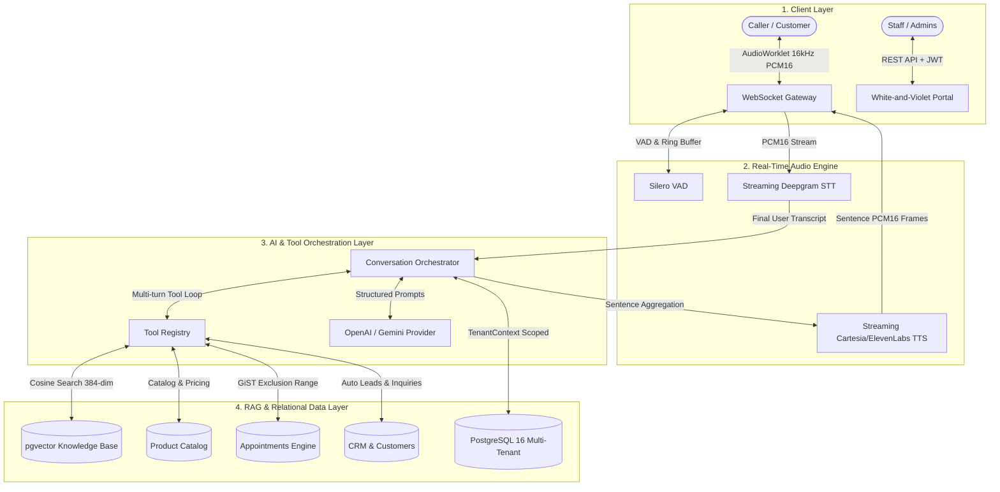

# FortiSales AI — Technical Presentation & Interview Preparation Guide

This comprehensive guide prepares engineers, architects, and founders to present, demonstrate, and explain FortiSales AI in technical interviews, investor presentations, and architectural reviews.

---

## 1. Executive 2-Minute Elevator Pitch

> "Traditional business phone trees and IVR menus frustrate customers with endless dial-pad options, while hiring round-the-clock sales receptionists is cost-prohibitive for most growing companies.
>
> **FortiSales AI** is an autonomous, enterprise-grade AI sales receptionist and CRM platform that answers inbound calls with natural, real-time voice under 500ms latency. Unlike generic chatbots, FortiSales AI is deeply grounded in each business's verified knowledge base using PostgreSQL `pgvector` RAG, ensuring it never invents pricing or policies.
>
> It autonomously qualifies sales leads, checks real-time staff availability, books conflict-free calendar appointments directly into PostgreSQL using mathematical exclusion constraints, and detects when a customer needs human attention—instantly escalating to staff with full conversational context.
>
> Built entirely in Python with FastAPI, PostgreSQL 16, and modern WebSockets, FortiSales AI delivers strict multi-tenant isolation, enterprise RBAC, and zero-external-cost local testing with deterministic mock providers."

---

## 2. 5-Minute Technical Architecture Walkthrough



### Key Subsystems:
1. **Real-Time Voice Engine (Stage 4)**:
   - Browser `AudioWorklet` captures 16kHz 16-bit mono PCM audio in 20ms frames (640 bytes).
   - Single-use 256-bit tickets issued via `POST /api/v1/voice/tickets` and redeemed atomically via Redis `GETDEL` (close code `4401` on invalid/expired ticket, `4403` on invalid origin).
   - Silero VAD detects speech onset and pauses; user speech during AI responses triggers immediate barge-in, cancelling active TTS streaming.
2. **Conversation Orchestrator & Tool Registry (Stage 3 & 7)**:
   - Centralized `ConversationOrchestrator.handle_message` manages context windows, token tracking, prompt templates, and tool loops.
   - The LLM emits structured tool calls (e.g. `check_appointment_availability`, `book_appointment`, `request_human_handoff`).
3. **Business Knowledge Base & RAG (Stage 5)**:
   - Documents (PDF, TXT, DOCX) are ingested, cleaned, chunked via sliding window (500 tokens with 100 token overlap), and stored as 384-dimensional vector embeddings in PostgreSQL using `pgvector` with cosine similarity (`<=>`).
   - Anti-hallucination rule: Structured product catalog pricing **always** overrides vector text chunks.
4. **CRM & Role-Based Workspaces (Stage 6)**:
   - Automatic customer creation and inquiry ticket creation from inbound calls.
   - Automatic lead generation upon call completion with qualification score (0–100) and tier (`cold`, `warm`, `hot`).
   - Three role-based portals: Admin (`/admin-dashboard`), Receptionist (`/receptionist-dashboard`), and Sales Rep (`/sales-dashboard`).
5. **Conflict-Free Appointment Engine (Stage 7)**:
   - Evaluates weekly business hours, holiday closures, special schedule overrides, and staff availability.
   - Guaranteed race-condition prevention using PostgreSQL GiST exclusion constraints (`tstzrange`).
6. **Human Handoff & AI Fallback (Stage 8)**:
   - Real-time keyword and intent detection ("speak to human", "connect to sales", "representative").
   - Live Handoff Queue in Receptionist workspace with one-click staff takeover (`POST /api/v1/conversations/{id}/takeover`).
   - Resilient AI fallback: catches upstream model/provider timeouts, safely records the customer turn, updates conversation to `handed_off`, and offers polite human callback without crashing.

---

## 3. The Complete Customer Journey (Trace Through Code)

Here is how a real phone interaction travels through every layer of FortiSales AI:

1. **Ticket Request & Authentication**:
   - Caller connects. Client requests single-use voice ticket: `POST /api/v1/voice/tickets`.
   - Backend creates `Call` (status `initiated`) and `Conversation` (status `active`), generating a cryptographically secure 256-bit token stored in Redis with 30s TTL.
2. **WebSocket Audio Handshake**:
   - Client opens `wss://.../voice/stream?ticket=tkt_...`.
   - Gateway verifies Origin (`4403` if untrusted) and atomically redeems ticket via Redis `GETDEL` (`4401` if missing/expired).
3. **Streaming Speech & VAD**:
   - Customer says: *"Hi, I'd like to know what your starting prices are for cloud security, and book a consultation for Friday."*
   - AudioWorklet streams binary PCM16 frames. Gateway feeds Silero VAD. VAD detects speech end after 400ms silence.
4. **Speech-to-Text**:
   - Deepgram streaming STT emits final transcript.
5. **Orchestrator & Tool Execution**:
   - `ConversationOrchestrator.handle_message` assembles prompt including business profile, operating status, and conversation history.
   - Model determines it needs product pricing and calls `get_product_or_service_details`.
   - Tool returns structured catalog data: Cloud Security starting price is \$1,200/mo.
   - Model determines it needs appointment slots and calls `get_available_appointment_slots(date="2026-11-27")`.
   - Candidate slots returned: 10:00 AM, 2:00 PM.
6. **Sentence-Level Streaming TTS**:
   - Model outputs: *"Our cloud security services start at \$1,200 per month depending on network scope. I have consultation slots available this Friday at 10:00 AM or 2:00 PM. Would either of those work for you?"*
   - SentenceAggregator splits text on punctuation boundaries, feeding sentences immediately to Cartesia/ElevenLabs TTS. Audio streams back to caller while model is still concluding the turn.
7. **Barge-In Handling (if customer interrupts)**:
   - Customer speaks: *"Actually, can I speak to a real person in sales?"*
   - Silero VAD fires speech onset trigger within 80ms.
   - Gateway sets `cancellation_event`, aborts active TTS playback, discards remaining audio frames, and sends `{type: "interrupted"}` to client.
8. **Human Escalation & CRM Logging**:
   - Customer's request triggers `request_human_handoff(reason="Customer requested real sales rep", urgency="high")`.
   - Tool updates `Conversation.status = "handed_off"`, `Call.status = "handed_off"`, creates an `Inquiry` ticket (`priority="high"`), and updates `Lead.qualification_tier = "hot"`.
   - Receptionist workspace alert fires with audio chime; pending handoff count badge increments.
   - Receptionist clicks **"Take Over Call"** (`POST /api/v1/conversations/{id}/takeover`). Call is assigned to the receptionist, and caller is connected with full history.

---

## 4. Codebase Study Guide (Ordered by Reading Priority)

Review these files in this exact order before any presentation or technical interview:

| Order | File Path | What to Inspect & Explain |
| :---: | :--- | :--- |
| **1** | `backend/app/core/tenant.py` & `backend/app/api/deps.py` | Explain `TenantContext` using Python `contextvars.ContextVar`. Show how JWT claims extract `org_id` and bind tenant boundary before request handling. |
| **2** | `backend/app/models/call.py` & `backend/app/models/appointment.py` | Point out the PostgreSQL GiST exclusion constraint preventing double-bookings. Show `Call` status check constraints and relations. |
| **3** | `backend/app/services/voice/gateway.py` | Walk through WebSocket handshake: Origin verification, atomic Redis `GETDEL` ticket redemption, 4401 vs 4403 close codes, ring buffer alignment. |
| **4** | `backend/app/services/voice/pipeline.py` | Explain full-duplex audio loop: Silero VAD, streaming STT, sentence aggregation, streaming TTS, and barge-in cancellation token. |
| **5** | `backend/app/ai/conversation/orchestrator.py` | Trace `handle_message`: bounded tool calling loop (max 3), structured turn intelligence extraction, and resilient AI fallback. |
| **6** | `backend/app/services/appointments/booking.py` | Show atomic revalidation query inside database transaction right before booking insertion. |
| **7** | `backend/app/services/rag/retriever.py` | Show `pgvector` cosine distance operator (`<=>`), metadata filtering, and catalog pricing precedence. |
| **8** | `backend/app/api/v1/conversations.py` | Show the Stage 8 Live Handoff Queue (`GET /handoffs`), takeover endpoint (`POST /takeover`), and CRM lead auto-generation. |

---

## 5. Deep Technical Concepts Explained

### 1. PostgreSQL `pgvector` Cosine Similarity
- **What it is**: `pgvector` stores floating-point vectors directly in PostgreSQL columns (`Vector(384)`).
- **How FortiSales AI uses it**: Knowledge chunks from company policies and FAQs are embedded into 384 dimensions. At query time, `retriever.py` executes:
  ```sql
  SELECT chunk_id, content, 1 - (embedding <=> :query_vector) AS similarity
  FROM knowledge_chunks
  WHERE org_id = :org_id
  ORDER BY embedding <=> :query_vector ASC
  LIMIT 3;
  ```
- **Why it matters**: Zero external vector database dependency (no Pinecone, no Weaviate, no Qdrant). Keeps transactional data and semantic vectors inside the same atomic ACID boundary.

### 2. GiST Exclusion Constraints (`btree_gist` + `tstzrange`)
- **What it is**: PostgreSQL GiST index enforcing that no two rows can have overlapping intervals.
- **How FortiSales AI uses it**:
  ```python
  ExcludeConstraint(
      (cast("employee_id", Text), "="),
      (func.tstzrange(column("start_time"), column("end_time"), "[)"), "&&"),
      where=column("status").in_(["scheduled", "confirmed"]),
      name="no_overlapping_appointments",
  )
  ```
- **Why it matters**: Completely eliminates double-booking race conditions even under extreme concurrent multi-threaded requests. Even if two clients click "Book" at the identical millisecond, PostgreSQL rejects the second insert with an integrity constraint violation.

### 3. Browser AudioWorklet vs. MediaRecorder / Polling
- **Traditional approach**: `MediaRecorder` buffers audio into chunks (e.g. 1–2 seconds) and sends via HTTP POST. Result: 2000ms+ latency, robotic conversation.
- **AudioWorklet approach**: Runs on a dedicated browser Web Audio thread with zero UI-thread jitter. Collects raw PCM samples directly from the microphone in 20ms slices (640 bytes) and streams them instantly over a persistent WebSocket. Result: sub-500ms conversational turn turnaround.

### 4. Atomic Redis `GETDEL` Single-Use Voice Tickets
- **What it is**: Ephemeral ticket tokens issued before WebSocket connection.
- **How FortiSales AI uses it**:
  ```python
  token_data = await redis_client.getdel(f"voice_ticket:{ticket_hash}")
  ```
- **Why it matters**: Redis `GETDEL` is atomic. A ticket cannot be re-used, intercepted, or shared across multiple browsers. Prevents ticket replay attacks and unauthorized audio eavesdropping.

### 5. 2-Byte PCM16 Sample Alignment
- **What it is**: 16-bit PCM audio consists of 2 bytes per sample (little-endian signed integer).
- **Why alignment matters**: If an odd number of bytes is dropped during network backpressure or ring buffer overflow, the high byte and low byte swap, turning subsequent audio into loud white noise. FortiSales AI enforces:
  ```python
  excess_bytes = buffer_len - max_bytes
  excess_bytes -= (excess_bytes % 2) # Strict 2-byte boundary
  ```

---

## 6. Top 10 Anticipated Technical Interview Questions & Answers

### Q1: How do you guarantee tenant isolation across thousands of organizations sharing one database?
> **Answer**: We enforce tenant isolation at three distinct layers:
> 1. Every model inherits from `TenantMixin`, which defines `org_id: Mapped[UUID]` with a database foreign key and index.
> 2. On every incoming request, our authentication dependency `get_current_user` validates the JWT signature, extracts `org_id`, and sets it in `TenantContext` using Python's thread-safe and async-safe `contextvars.ContextVar`.
> 3. All service queries, vector searches, and mutations filter explicitly on `org_id == TenantContext.get_current_tenant_id()`. Cross-tenant data retrieval is impossible because the `org_id` is derived from the cryptographically signed JWT, never from user-supplied query parameters or payload bodies.

### Q2: How does the voice pipeline achieve barge-in when a customer interrupts the AI?
> **Answer**: The voice gateway runs a full-duplex WebSocket session. While the backend streams sentence-by-sentence TTS audio to the client, the client's microphone audio continues streaming into the gateway. Silero VAD evaluates inbound audio every 20ms. When speech energy exceeds the VAD threshold for 80ms, the pipeline sets an `asyncio.Event` cancellation token. The TTS streaming loop checks this event before every sentence, instantly terminating playback, clearing the audio output buffer, and resetting the AI turn.

### Q3: Why did you choose `pgvector` instead of a dedicated vector database like Pinecone or Qdrant?
> **Answer**: Using `pgvector` directly in PostgreSQL 16 keeps our architecture simple, robust, and ACID-compliant. Document records, knowledge chunks, embeddings, and CRM entities live in the same database. When an admin deletes a document or updates an FAQ, a single database transaction deletes both the metadata and the vector embeddings atomically. Furthermore, it eliminates cross-service network latency, sync synchronization issues, and third-party SaaS hosting costs.

### Q4: How do you prevent the AI from hallucinating pricing or company policies?
> **Answer**: We use a two-tiered factual grounding architecture:
> First, our system prompt strictly prohibits inventing numerical pricing or quoting unauthorized terms.
> Second, our tool registry enforces precedence: when a customer inquires about offerings or costs, the model executes `get_product_or_service_details`. Verified, structured catalog records in the database **always** take precedence over unstructured vector text chunks. If neither catalog nor RAG contains the answer, the model is instructed to honestly admit it does not have that information and offer human follow-up.

### Q5: What happens if two customers attempt to book the exact same appointment slot simultaneously?
> **Answer**: We use dual-layer concurrency protection:
> 1. At the application layer, `BookingService` executes an immediate revalidation query inside an async database transaction before inserting the appointment.
> 2. At the database engine layer, PostgreSQL enforces a GiST exclusion constraint (`no_overlapping_appointments`) combining the employee ID and a `tstzrange` timestamp interval. Even under concurrent race conditions where two transactions pass the application check simultaneously, the PostgreSQL storage engine serializes the write and raises an `IntegrityError` on the second transaction, which our service catches and cleanly surfaces as a 409 Conflict.

### Q6: How do you prevent unauthorized voice connections or replay attacks on the voice WebSocket?
> **Answer**: Browsers cannot securely send custom Authorization headers during a standard WebSocket handshake. We solved this with single-use, 256-bit cryptographically secure tickets (`tkt_...`). The client must first make an authenticated HTTPS `POST /api/v1/voice/tickets` request using their JWT. The backend hashes the ticket using SHA-256 and stores it in Redis with a 30-second TTL. When the WebSocket connects, the gateway reads the raw ticket, hashes it, and executes an atomic Redis `GETDEL`. If the ticket was already redeemed or expired, the connection is closed immediately with code `4401`. Untrusted browser origins are closed with code `4403`.

### Q7: What is the purpose of Sentence-Level Response Streaming in TTS?
> **Answer**: If we waited for the entire LLM response to complete before calling Text-to-Speech, a 3-sentence reply would take 2 to 3 seconds to synthesize, creating awkward dead air. Instead, our `SentenceAggregator` buffers tokens until a sentence boundary (`.`, `!`, `?`, or `,`) is reached. The first sentence is dispatched to Cartesia or ElevenLabs streaming TTS within 200ms of generation, allowing audio to start playing in the caller's ear while the LLM is still finishing subsequent sentences.

### Q8: What happens if the remote AI provider (OpenAI or Gemini) suffers an outage or network timeout during a live call?
> **Answer**: In Stage 8, we implemented a resilient AI Fallback system. In `ConversationOrchestrator.handle_message`, if an unhandled remote provider exception or timeout occurs, rather than crashing the WebSocket with an unhandled 500 error, the orchestrator catches the failure, logs the incident, safely records the customer's turn, sets `Conversation.status = "handed_off"` and `Call.status = "handed_off"`, and returns a polite fallback response: *"I apologize, but I am experiencing technical difficulties retrieving that information. I have escalated this conversation to our support team, and a representative will follow up with you promptly."* The call immediately appears in the receptionist's live handoff queue for human takeover.

### Q9: How does the platform maintain strict sales representative isolation?
> **Answer**: In Stage 6, we implemented a strict RBAC hierarchy. While administrators and receptionists can view organization-wide customer activity and assign leads, sales employees (`sales_employee` role) are restricted to their own assignments:
> - `GET /api/v1/leads/my`: Returns only leads where `assigned_employee_id == current_user.employee_id`.
> - `GET /api/v1/appointments/my-calendar`: Returns only appointments booked with that specific employee.
> - Attempting to view another sales rep's lead or client returns a 404 or 403 Forbidden error.

### Q10: How can developers test FortiSales AI locally without incurring third-party API costs?
> **Answer**: Every external service has a first-class, deterministic mock implementation:
> - `DEFAULT_AI_PROVIDER="openai"` operates against local mock providers when API keys are unset.
> - `STT_PROVIDER="mock"` delivers simulated transcription without Deepgram credentials.
> - `TTS_PROVIDER="mock"` generates valid PCM16 silence frames for real-time AudioWorklet validation.
> - If Redis is offline, the voice gateway automatically falls back to a thread-safe in-memory ticket store.
> - All 134 automated unit and integration tests run entirely locally against PostgreSQL 16.

---

## 7. Step-by-Step Live Demonstration Script

Follow this sequence during a 10-minute live demo:

### Phase 1: Authentication & Workspace Routing (2 mins)
1. Open `http://localhost:8000/`.
2. Log in as an **Admin** (`admin@demo.com`):
   - Show the Admin dashboard with org-wide metrics, service catalogue, and operating hours.
3. Log in as a **Front Desk Receptionist** (`receptionist@demo.com`):
   - Show the Receptionist Workspace, Month/List calendar view, and Customer Directory.

### Phase 2: Autonomous Voice Interaction & Knowledge Retrieval (3 mins)
1. Open `http://localhost:8000/voice-console`.
2. Click **"Connect"** (show single-use ticket handshake in network tab).
3. Speak into microphone: *"What are your opening hours on Friday, and what does your security consultation cost?"*
4. Highlight:
   - Near-instantaneous response (<500ms).
   - Accurate citation from verified business settings and catalog.
   - Clean spoken formatting (no markdown symbols or bullet points).

### Phase 3: Appointment Booking with Conflict Prevention (3 mins)
1. Speak into microphone: *"I'd like to book an appointment for Friday at 10 AM."*
2. AI checks slots and asks for confirmation: *"I have an opening this Friday at 10:00 AM with our sales specialist. Shall I go ahead and book that for you?"*
3. Speak: *"Yes, please confirm it."*
4. Switch to Receptionist Portal (`/receptionist-dashboard`):
   - Click **Calendar**: Show the newly scheduled appointment immediately appearing on Friday at 10:00 AM!
   - Show that attempting to double-book this slot is prevented by PostgreSQL GiST exclusion.

### Phase 4: Human Handoff & Staff Takeover (2 mins)
1. In the voice console, say: *"I need to speak with a human manager immediately."*
2. AI responds warmly: *"I have escalated your call to our human representative team. A specialist has been notified and will take over or follow up with you directly."*
3. Switch to Receptionist Portal:
   - Notice the **🚨 Handoffs** badge increment to `1`!
   - Open **Handoff Queue**: View the caller phone number, escalation reason, and turns.
   - Click **"Take Over Call"**: Show the status switch to "Taken Over" and assigned staff member recorded.
