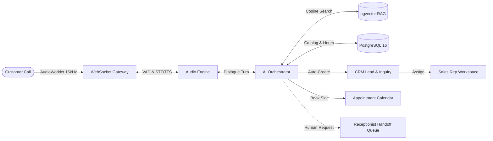

# FortiSales AI — Autonomous AI Sales Voice Agent

## 1. Project Overview
**FortiSales AI** is an enterprise-grade, multi-tenant autonomous AI sales voice receptionist and customer relationship management (CRM) platform. Designed for modern sales teams and service organizations, FortiSales AI answers incoming telephone and browser calls in natural, low-latency spoken voice, answers customer questions accurately using a verified company knowledge base (Retrieval-Augmented Generation), conversationally qualifies sales prospects, schedules conflict-free calendar appointments, and escalates to human staff when live assistance is required.

---

## 2. Problem Statement
Growing businesses face critical revenue leakage from inbound call handling:
- **Missed Sales Inquiries**: Up to 30% of customer calls occur after business hours or during peak traffic, resulting in lost prospects.
- **High Operational Costs**: Staffing 24/7 human sales receptionists is cost-prohibitive for small and medium enterprises.
- **Repetitive Inquiries & Inconsistent Information**: Receptionists spend valuable time answering repetitive pricing and policy questions, often misquoting terms or failing to capture structured customer data.
- **Delayed Lead Follow-Up**: Uncaptured inquiries sit in voicemail for hours or days, causing lead decay before sales representatives can reach out.
- **Scheduling Friction & Double-Booking**: Manual appointment coordination requires tedious back-and-forth communication and frequently leads to calendar conflicts.

---

## 3. Proposed Solution
FortiSales AI solves these challenges with an autonomous, voice-first AI receptionist:
- **Instant Spoken Conversations**: Inbound callers interact with an expressive, natural voice agent with sub-500ms conversational turn latency.
- **Factual, Hallucination-Free RAG**: The agent answers questions strictly using company documents, policies, and product catalogs stored in PostgreSQL `pgvector`, with structured catalog pricing always taking precedence over unstructured text chunks.
- **Automated CRM Pipeline**: Every completed conversation automatically creates or updates customer profiles, computes a lead score (0–100), assigns a qualification tier (`cold`, `warm`, `hot`), and opens actionable inquiry tickets.
- **Conflict-Free Scheduling**: Integrates directly with employee calendars, verifying operating hours, holidays, and staff availability before booking appointments protected by database-level exclusion constraints.
- **Seamless Human Handoff**: Detects customer requests for human assistance, queues the call in real time on the receptionist workspace, and enables one-click live takeover.

---

## 4. Key Implemented Features
- **Real-Time Voice Engine**: Browser AudioWorklet streaming 16kHz PCM16 audio over WebSockets with Silero VAD, Deepgram streaming STT, sentence-level streaming TTS (Cartesia / ElevenLabs), and 80ms barge-in interruption handling.
- **Business Knowledge Base & RAG**: Semantic vector retrieval using 384-dimensional pgvector cosine distance (`<=>`), sliding-window chunking (500 tokens, 100 overlap), and document ingestion for PDF, DOCX, and TXT files.
- **Autonomous Conversation Orchestrator**: Multi-turn dialogue management, anti-hallucination prompt boundaries, and backend tool execution (`get_business_information`, `get_business_hours`, `get_ai_availability`, `query_knowledge_base`, `get_product_or_service_details`, `request_human_handoff`).
- **Calendar & Appointment Engine**: Precedence-based availability resolution and atomic booking protected against race conditions via PostgreSQL GiST exclusion constraints (`btree_gist`).
- **Role-Based Workspaces**: Three role-isolated portals built on a cohesive White-and-Violet design system:
  - *Admin Workspace* (`/admin-dashboard`): Org profile, hours, holidays, services catalog, and staff management.
  - *Receptionist Workspace* (`/receptionist-dashboard`): Month/List calendar, appointment booking/rescheduling, customer directory, inquiries, and live handoff queue.
  - *Sales Rep Workspace* (`/sales-dashboard`): Assigned lead pipeline, stage tracking (`new` $\to$ `contacted` $\to$ `qualified` $\to$ `converted`), and read-only personal schedule.
- **Basic Human Handoff & AI Fallback**: Real-time intent detection, live queue visibility, employee takeover API, and resilient fallback on upstream model outages.

---

## 5. Technology Stack
- **Backend Framework**: Python 3.11, FastAPI (asynchronous REST & WebSocket gateways).
- **Relational & Vector Database**: PostgreSQL 16 with `pgvector` (vector similarity search) and `btree_gist` (concurrency exclusion constraints).
- **Data Access & Migrations**: SQLAlchemy 2.0 (Asyncpg async driver & Psycopg2 sync driver), Alembic migration engine.
- **Distributed State & Caching**: Redis 7+ (ephemeral 256-bit single-use voice tickets with atomic `GETDEL`; automatic in-memory fallback for local development).
- **Speech & Audio Processing**: Deepgram Nova-2 (streaming STT), Cartesia Sonic / ElevenLabs (streaming TTS), Silero VAD (voice activity detection).
- **AI & Language Models**: OpenAI (`gpt-4o-mini`) and Google Gemini (`gemini-1.5-flash`) via unified abstraction layer; deterministic mock providers for offline testing.
- **Frontend Architecture**: Pure Vanilla HTML5, modern CSS3 (custom White-and-Violet tokens), and asynchronous JavaScript ES6+ (Web Audio API `AudioWorkletNode`). Zero npm/node build steps required.

---

## 6. Architecture & Workflow

**Main Workflow**:
$$\text{Customer Call} \longrightarrow \text{Voice Gateway (VAD/STT)} \longrightarrow \text{AI Orchestrator} \longrightarrow \text{Knowledge Base (RAG)} \longrightarrow \text{CRM Lead} \longrightarrow \text{Appointment Booking} \longrightarrow \text{Human Handoff (if needed)}$$

---

## 7. Security & Isolation Safeguards
- **Multi-Tenant Isolation**: Enforced at the query level via `TenantContext` using Python's async-safe `contextvars.ContextVar`. All relational records and vector chunks are bounded by `org_id`.
- **Authentication & RBAC**: Scrypt RFC 7914 password hashing, cryptographically signed JWT access/refresh tokens with rotation, and strict role hierarchy (`owner` > `admin` > `receptionist` > `sales_employee`).
- **Secure Voice Gateway**: Ephemeral single-use 256-bit tickets redeemed atomically via Redis `GETDEL` (close code `4401` on expired ticket, `4403` on unauthorized Origin).
- **Collision-Safe Scheduling**: PostgreSQL GiST exclusion constraint (`tstzrange`) guarantees zero overlapping appointments for any staff member at the storage engine level.

---

## 8. Current Project Status & Local Execution
- **Implementation Status**: Stages 1 through 10 are **100% complete** and validated by **134 passing automated tests**.
- **Out of Scope / Deferred**: Advanced external notification networks (Twilio SMS/WhatsApp trunking) and public cloud container orchestration (AWS/Kubernetes) are deferred to future production milestones.
- **Local Execution**: The application runs completely locally on Windows/Linux with Python 3.11, local PostgreSQL 16, and Uvicorn (`uvicorn backend.app.main:app --reload --port 8000`).
