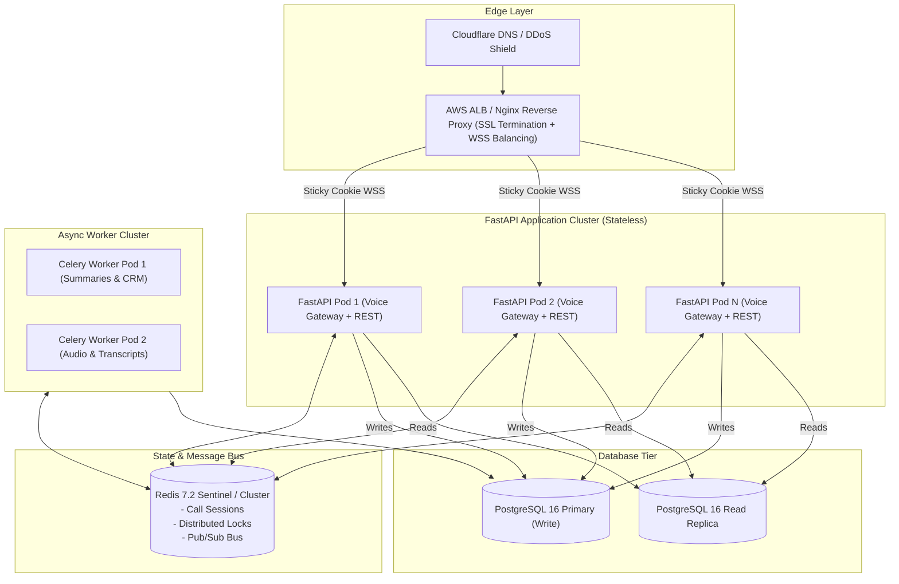

# FortiSales AI – Scalability & Security Architecture

## 1. Concurrency Disambiguation & Capacity Engineering

To avoid misleading claims, system load must be mathematically decomposed into four distinct concurrency tiers:

1. **Registered Users ($N_{reg} = 100,000$)**:
   - Total user entities stored in PostgreSQL across all tenant organizations.
   - Database storage footprint: $100,000 \times \sim 1\text{ KB} \approx 100\text{ MB}$ (trivial database sizing).
2. **Daily Active Users (DAU $\approx 10,000 - 15,000$)**:
   - Staff members logging in, reviewing dashboard analytics, checking leads, or adjusting schedules.
   - Peak REST API traffic: $\sim 50 - 150\text{ requests/sec}$ (well within a single FastAPI/Uvicorn worker pool).
3. **Concurrent Active Calls ($C_{calls}$)**:
   - Simultaneous live voice calls actively processed by the system.
   - Industry benchmark for a 100k user base with ~1,000 SMB/Enterprise tenants: **100 to 500 concurrent active calls** during peak business hours.
4. **Concurrent WebSocket Connections ($W_{conns}$)**:
   - Inbound telephony audio streams: $1 \times C_{calls}$.
   - Live receptionist monitoring dashboards: $\sim 50 - 200$ staff connections.
   - Total concurrent WebSockets: **150 to 700 connections**.
5. **Concurrent AI Inference Operations ($I_{ops}$)**:
   - Voice interactions are half-duplex by nature (either the user is speaking or the AI is speaking, plus short pauses).
   - At any given second during $C_{calls} = 200$:
     - $\sim 40\%$ callers are speaking (80 streaming STT sessions).
     - $\sim 40\%$ AI is speaking (80 streaming TTS sessions).
     - $\sim 15\%$ LLM is generating tokens (30 concurrent LLM streams).
     - $\sim 5\%$ silence / VAD deliberation.

### Bandwidth & Compute Calculations for 200 Concurrent Calls:
- **Audio Ingress/Egress**:
  - Uncompressed PCM 16kHz 16-bit mono = $256\text{ kbps} = 32\text{ KB/s}$ per channel.
  - Opus / $\mu$-law telephony stream = $64\text{ kbps} = 8\text{ KB/s}$ per channel.
  - 200 calls $\times 64\text{ kbps} \times 2\text{ (bidirectional)} = 25.6\text{ Mbps}$ network throughput.
- **FastAPI / Uvicorn Capacity**:
  - Python `asyncio` with `uvloop` effortlessly maintains 2,000+ idle WebSockets.
  - With in-memory VAD framing (20ms chunks every 20ms per call = 50 frames/sec/call), 200 calls generate $10,000\text{ events/sec}$.
  - A single 8-core compute instance running 4 Uvicorn workers handles this load comfortably at $<45\%$ CPU utilization.

---

## 2. Horizontal Scaling & Load Balancing Architecture



### Key Scaling Strategies:
1. **Sticky Session Load Balancing**:
   - WebSockets require stable persistent connections. The load balancer uses a sticky cookie (`SERVERID`) or IP hashing during the initial WebSocket handshake to pin the call to a specific FastAPI instance.
2. **Stateless App Tier**:
   - Because all ephemeral call state is stored in Redis, if an application instance abruptly fails, the call session can reconnect and recover its conversation history from Redis without data loss.
3. **Database Read/Write Splitting**:
   - Writes (call starts, appointment locks, lead creation) route to PostgreSQL Primary.
   - Analytics, historical call log queries, and knowledge base vector searches route to Read Replicas.
4. **Celery Worker Auto-Scaling**:
   - Celery workers scale independently based on Redis task queue length (`tasks.process_post_call`).

---

## 3. High Availability, Fault Tolerance & Rate Limiting

### 3.1 Tiered Rate Limiting
To prevent denial-of-service and protect downstream LLM quotas:
- **Tenant API Quotas**: Enforced via Redis Token Bucket algorithm:
  - Staff REST endpoints: 120 requests/minute per IP/User.
  - Inbound Call Ingestion: Configured max concurrent calls per organization (e.g., 5 to 50 concurrent lines per subscription tier).
- **LLM Rate Limit Circuit Breaker**:
  - If upstream LLM provider returns HTTP 429 or 503, a Redis-backed circuit breaker trips to `OPEN` for 30 seconds, automatically routing subsequent prompts to the secondary fallback model (Gemini $\leftrightarrow$ OpenAI).

### 3.2 Health Checks & Liveness Probes
- `GET /health/live`: Fast process ping (returns 200 if event loop is unblocked).
- `GET /health/ready`: Validates active connections to PostgreSQL, Redis, and external STT/LLM provider network egress.

---

## 4. Comprehensive Security Architecture

### 4.1 Authentication & Authorization
- **JWT Architecture**:
  - Access Token: RS256 signed, 15-minute expiration, contains `user_id`, `org_id`, and `role`.
  - Refresh Token: Stored as cryptographically secure random 256-bit hash in PostgreSQL, 7-day expiration with sliding-window rotation.
- **Tenant Data Isolation**:
  - Every SQL query generated by SQLAlchemy enforces an explicit `WHERE org_id = :current_user_org_id` filter.
  - PostgreSQL Row-Level Security (RLS) can be enabled as a defense-in-depth barrier:
    ```sql
    ALTER TABLE customers ENABLE ROW LEVEL SECURITY;
    CREATE POLICY customer_isolation_policy ON customers
      FOR ALL USING (org_id = current_setting('app.current_org_id')::uuid);
    ```

### 4.2 Customer Privacy & Audio Recording Consent
- **Mandatory Consent Workflow**:
  - At the start of every inbound call, the AI executes an automated compliance check against `business_settings.recording_consent_required`.
  - If enabled, the initial greeting explicitly includes: *"This call may be recorded for quality and training purposes. Press 1 or continue speaking to proceed."*
  - If the caller explicitly objects, the audio recording flag is set to `false`, disabling recording disk persistence while keeping real-time transcription active for live interaction.
- **Data Protection & PII Masking**:
  - Call transcripts pass through an automated Named Entity Recognition (NER) filter to redact credit card numbers (PCI-DSS), Social Security / National IDs, and sensitive health information before permanent database storage.

### 4.3 Cryptographic Standards & Key Management
- **In-Transit**: Mandatory TLS 1.3 for all REST endpoints and WebSockets (HTTPS / WSS). SIP traffic encrypted via SRTP/TLS.
- **At-Rest**:
  - Relational database encrypted using AES-256 block storage encryption.
  - Audio files in object storage encrypted using server-side KMS encryption (SSE-KMS).
- **Secret Management**:
  - Zero hardcoded credentials. All API keys (OpenAI, Gemini, Twilio, DB passwords) injected at container runtime via environment variables loaded from Docker secrets or AWS Secrets Manager / HashiCorp Vault.

### 4.4 Immutable Audit Logging
- Every administrative configuration change, role modification, schedule override, document upload, and manual call takeover writes an immutable row to `audit_logs`.
- Logs include `user_id`, `ip_address`, `timestamp`, `action`, and a structured JSON `payload_diff` capturing the pre-change and post-change attributes.
