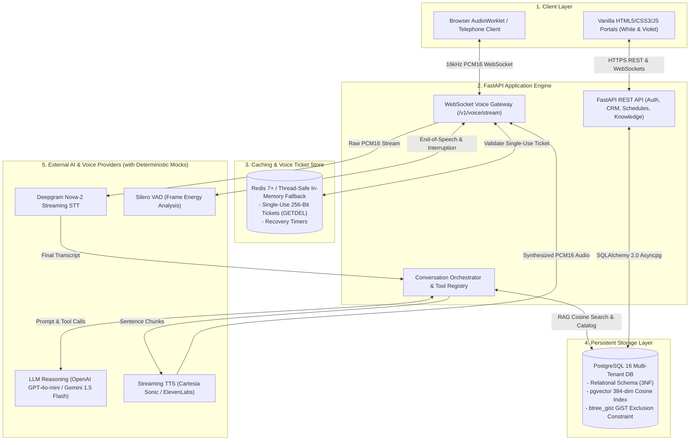
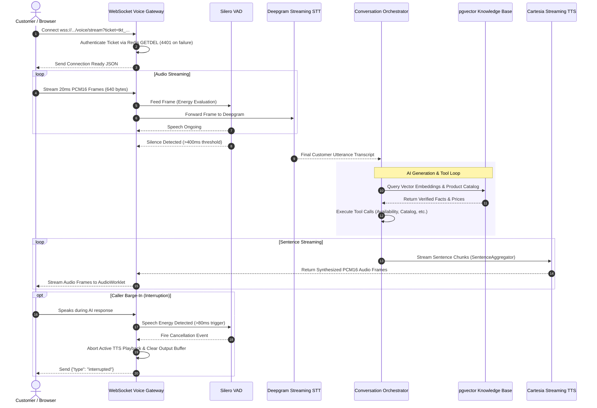

# FortiSales AI – System Architecture Specification

## 1. Architectural Overview & Design Philosophy

**FortiSales AI** is engineered as a decoupled, event-driven architecture built around real-time asynchronous streaming pipelines. It bridges browser and telephone voice traffic with generative AI models and business operational systems (CRM, scheduling, knowledge bases).

The core design principles are:
1. **Low-Latency Streaming First**: Every audio and token pathway uses streaming (WebSockets, binary PCM16 audio, chunked TTS) to achieve sub-500ms conversational turnaround.
2. **Strict Session & Multi-Tenant Isolation**: Every call executes in an encapsulated state machine. All relational queries and vector lookups are strictly bounded by `org_id` using Python's async-safe `contextvars.ContextVar`.
3. **Resilience & Graceful Degradation**: Subsystem failures (e.g. remote AI provider timeout, Redis offline in local dev) fall back to deterministic safety mechanisms rather than terminating calls.
4. **Developer Pragmatism & Zero-Build Lightweight Frontend**: Built with Python 3.11, FastAPI, PostgreSQL 16, and pure Vanilla HTML5/CSS3/ES6+ JavaScript (Web Audio API `AudioWorkletNode`), eliminating bulky Node.js/npm build steps and allowing the entire stack to run locally with `uvicorn`.

---

## 2. Implemented Technology Stack & Architectural Justification

| Component | Final Implemented Decision | Architectural Justification |
|---|---|---|
| **Backend Framework** | **FastAPI (Python 3.11+)** | Native async/await event loops, high WebSocket concurrency, first-class Python AI library ecosystem, automatic OpenAPI documentation, and Pydantic v2 data validation. |
| **Primary Database** | **PostgreSQL 16** | Robust ACID transactional guarantees, multi-tenant relational schema, `pgvector` for vector similarity, and `btree_gist` for GiST exclusion constraints preventing appointment double-booking. |
| **Data Access & ORM** | **SQLAlchemy 2.0 (Async)** | Full `asyncio` compatibility with Asyncpg driver, declarative mapping, strong typing, and reliable connection pooling; Psycopg2 for Alembic migrations. |
| **Cache & State Store** | **Redis 7+ (with In-Memory Fallback)** | Ephemeral 256-bit single-use voice tickets with atomic `GETDEL` redemption. Automatic thread-safe in-memory fallback engages when Redis is unconfigured in local dev. |
| **Real-Time Voice Protocol** | **WebSockets + PCM16** | Full-duplex bidirectional streaming of 16kHz linear PCM16 mono audio frames (20ms = 640 bytes) with 2-byte sample alignment and bounded ring buffers. |
| **Speech-to-Text (STT)** | **Deepgram Nova-2** | Sub-150ms streaming transcription over WebSockets, with deterministic mock provider for zero-cost offline testing. |
| **Voice Activity Detection** | **Silero VAD** | 20ms frame evaluation, 80ms speech trigger for instant barge-in response cancellation, and 400ms silence timeout for end-of-speech turnaround. |
| **Text-to-Speech (TTS)** | **Cartesia Sonic / ElevenLabs** | Low-latency streaming TTS coupled with `SentenceAggregator` chunking sentences at punctuation marks so audio begins playing while subsequent sentences are being generated. |
| **LLM Reasoning** | **OpenAI (`gpt-4o-mini`) & Gemini (`gemini-1.5-flash`)** | Dual-provider abstraction (`BaseLLMProvider`) with tool execution loops bounded at 3 turns, strict anti-hallucination boundaries, and deterministic mock providers. |
| **Vector Search & RAG** | **PostgreSQL `pgvector`** | 384-dimensional dense embeddings with cosine similarity distance (`<=>`), eliminating separate vector DB hosting and ensuring transactional deletion cascades. |
| **Frontend UI** | **Vanilla HTML5, CSS3, ES6+ JS** | Dedicated White-and-Violet role-based workspaces (`admin.html`, `receptionist-portal.html`, `sales.html`, `login.html`, `receptionist.html`) with zero npm build steps. |
| **Browser Audio Engine** | **Web Audio API AudioWorklet** | `pcm-processor.js` runs on a dedicated Web Audio rendering thread, capturing microphone input and playing synthesized speech without UI-thread jitter. |

---

## 3. Real-Time Voice Streaming Subsystem

Turnaround latency is the primary quality metric of an AI voice receptionist. A linear request-response architecture (Listen $\to$ Transcribe $\to$ Generate $\to$ Speak) introduces unacceptable delays of 2,000–3,500ms.

FortiSales AI employs an **Asynchronous Pipelined Streaming Architecture**:

---

## 4. Multi-Tenant Security & Isolation Architecture

1. **Context-Local Tenant Binding**:
   - Inbound HTTP and WebSocket requests authenticate via JWT or voice ticket.
   - `TenantContext` binds `org_id` using Python's `contextvars.ContextVar`. Every downstream service and query automatically inherits this tenant boundary without parameter passing.
   - A global middleware clears `TenantContext` upon every request completion or exception.
2. **Cryptographically Secure Single-Use Voice Tickets**:
   - Browsers cannot securely send custom HTTP Authorization headers during standard WebSocket establishment.
   - Clients obtain single-use 256-bit tickets via authenticated HTTPS `POST /api/v1/voice/tickets`.
   - The ticket hash is saved in Redis with a 30-second TTL. The WebSocket gateway redeems the ticket atomically via `GETDEL`, guaranteeing single-use protection and immunity to replay attacks.
3. **Database Concurrency Protection**:
   - Appointments use a PostgreSQL GiST exclusion constraint (`no_overlapping_appointments`) combining `employee_id` and `tstzrange(start_time, end_time, '[)')`. Double-bookings are impossible at the database storage engine layer.
