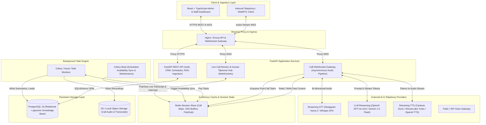
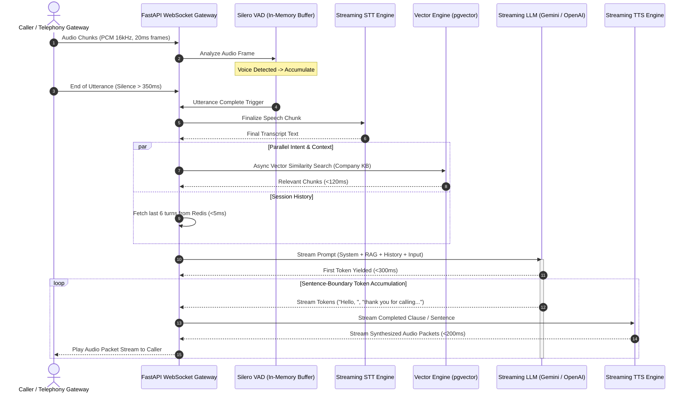
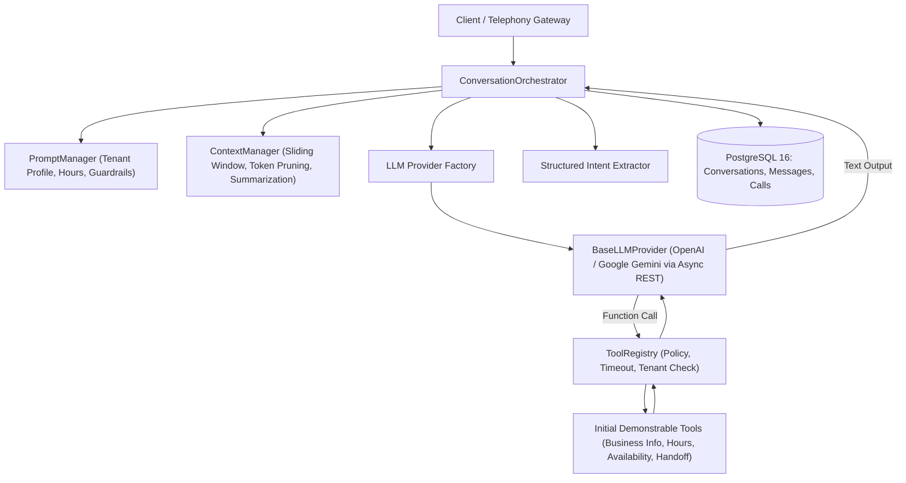
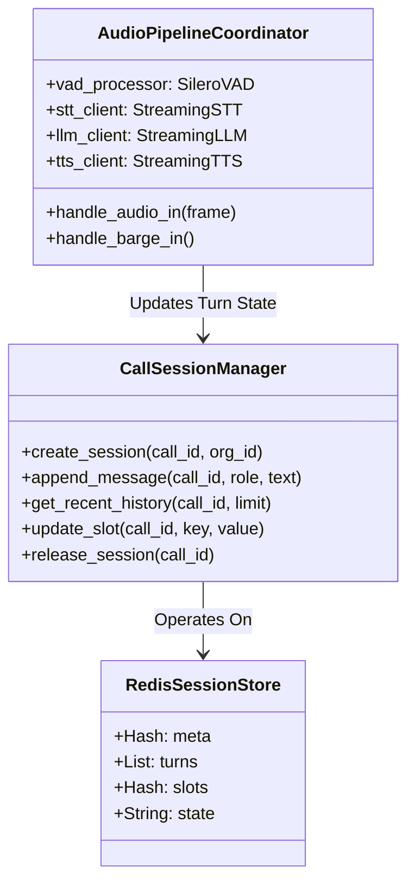
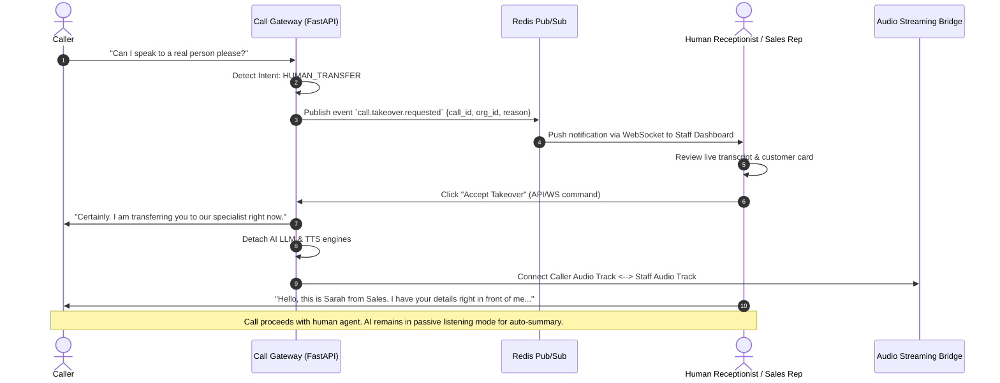

# FortiSales AI – System Architecture Specification

## 1. Architectural Overview & Design Philosophy

**FortiSales AI** is engineered as a decoupled, event-driven, micro-modular architecture built around real-time asynchronous streaming pipelines. It bridges telephone/WebRTC voice traffic with generative AI models and business operational systems (CRM, scheduling, knowledge bases).

The core design principles are:
1. **Low-Latency Streaming First**: Every audio and token pathway uses streaming (WebSockets, SSE, chunked audio) to achieve sub-second conversational turnaround.
2. **Strict Session Isolation**: Every call executes in an encapsulated state machine backed by Redis, ensuring zero memory leakage between simultaneous calls.
3. **Resilience & Graceful Degradation**: Subsystem failures (e.g., RAG vector search timeout, rate limiting) fall back to deterministic safety mechanisms rather than terminating calls.
4. **Developer Pragmatism & Maintainability**: Clean boundaries between asynchronous I/O (FastAPI WebSockets), background tasks (Celery/Redis), and relational persistence (PostgreSQL/SQLAlchemy).



---

## 2. Technology Stack Evaluation & Selection Rationale

The suggested stack was rigorously assessed for latency, developer velocity, multi-call scalability, and operational complexity:

| Component | Proposed in Prompt | Evaluated Options | Final Decision | Architectural Justification |
|---|---|---|---|---|
| **Frontend** | React + TypeScript | React + TS, Next.js, Vue 3 | **React + TypeScript (Vite)** | Single Page Application (SPA) with Vite provides near-instant HMR, strict type safety, rich WebRTC/WebSocket support, and zero server-side rendering (SSR) overhead for internal dashboards. |
| **Backend Framework** | FastAPI | FastAPI, Node.js (NestJS), Go | **FastAPI (Python 3.11+)** | Native async/await event loops (`uvloop`), high WebSocket concurrency, first-class integration with Python AI/ML libraries, automatic OpenAPI documentation, and Pydantic v2 data validation. |
| **Primary Database** | PostgreSQL | PostgreSQL, MySQL, MongoDB | **PostgreSQL 16** | Robust ACID transactional guarantees for booking slots, multi-tenant relational schema, strong indexing, and native extension ecosystem (`pgvector`, `uuid-ossp`). |
| **ORM** | SQLAlchemy | SQLAlchemy 2.0, Tortoise ORM, Prisma | **SQLAlchemy 2.0 (Async)** | Industry standard for Python; version 2.0 delivers full `asyncio` compatibility, declarative mapping, strong typing with Mypy, and reliable connection pooling. |
| **Cache & State** | Redis | Redis, Dragonfly, KeyDB | **Redis 7.2** | Sub-millisecond latency for live call context buffers, atomic locks for appointment booking, TTL eviction for stale sessions, and Redis Pub/Sub for real-time human takeover broadcast. |
| **Real-time Protocol** | WebSockets | WebSockets, gRPC, WebRTC | **WebSockets + WebRTC (Hybrid)** | WebSockets for bidirectional raw audio framing and control messages between client/telephony gateway and FastAPI; WebRTC for zero-latency peer-to-peer human takeover bridging. |
| **LLM Reasoning** | OpenAI API & Gemini API | OpenAI (GPT-4o / GPT-4o-mini), Gemini 1.5 Flash, Anthropic Claude 3.5 Haiku | **Hybrid: Gemini 1.5 Flash + OpenAI GPT-4o-mini** | Dual-provider strategy: **Gemini 1.5 Flash** as primary (superb speed, low cost, 1M+ token context for complex RAG synthesis) with **OpenAI GPT-4o-mini** as automatic failover. |
| **Vector Database** | ChromaDB | ChromaDB, PostgreSQL (`pgvector`), Qdrant | **PostgreSQL (`pgvector`) [Primary] / ChromaDB [Local Dev Fallback]** | Running `pgvector` inside PostgreSQL eliminates operating a separate vector database cluster, provides transactional consistency between metadata and embeddings, and enforces tenant isolation in single queries. |
| **Embeddings** | Sentence Transformers | Local Sentence Transformers (`all-MiniLM-L6-v2`), OpenAI `text-embedding-3-small` | **Hybrid: Local Sentence Transformers (`all-MiniLM-L6-v2`) + OpenAI `text-embedding-3-small`** | Local model allows zero API cost and low latency for small chunks; cloud embedding API provides higher dimensionality when cloud resources are preferred. |
| **Background Processing**| Celery | Celery, Taskiq, ARQ | **Celery + Redis Broker** | Battle-tested for heavy post-call transcription summarization, CRM webhook dispatches, and periodic scheduled sync (Celery Beat). For purely async lightweight tasks, FastAPI `BackgroundTasks` handle sub-100ms jobs. |
| **Containerization** | Docker | Docker + Compose, Podman, Kubernetes | **Docker + Docker Compose** | Multi-container reproducible environment (FastAPI backend, React frontend, PostgreSQL with pgvector, Redis, Celery worker, Celery beat). |

---

## 3. Real-Time Voice Streaming Subsystem

Turnaround latency is the single most critical quality metric of a voice agent. Human conversational cadence expects responses within 500–800ms. A linear request-response architecture (Listen $\to$ Transcribe $\to$ Generate $\to$ Speak) introduces unacceptable delays of 2000–3500ms.

FortiSales AI employs an **Asynchronous Pipelined Streaming Architecture**:



### Barge-In / Interruption Handling Mechanics:
1. While the AI is playing synthesized audio to the caller, the client/telephony stream continues streaming caller audio to FastAPI.
2. If `Silero VAD` detects caller voice energy above a dynamic threshold for $>180\text{ms}$ while the system state is `SPEAKING`:
   - FastAPI instantly sends a `STOP_AUDIO` control frame to the client/caller to mute and flush local playback buffers.
   - The active LLM stream task and TTS synthesis task are canceled via `asyncio.Task.cancel()`.
   - The system state transitions to `LISTENING`, and the incoming audio is redirected into the active transcription accumulator.

---

### 3.2 AI Conversation Engine & Tool Registry Architecture (Stage 3)

The AI conversation layer abstracts LLM interactions and orchestrates secure, context-aware dialogue:



#### Key Architecture Components:
1. **Provider Abstraction Layer (`backend/app/ai/providers/`)**:
   - `BaseLLMProvider`: Defines common interface `generate_response()` and `stream_response()` accepting typed `ChatMessage` and `ToolDefinition`.
   - Standardized `LLMResponse` encapsulating generated text, tool calls, and usage metrics.
   - Decoupled REST implementations for OpenAI (`OpenAIProvider`) and Google Gemini (`GeminiProvider`) using `httpx.AsyncClient` with zero SDK dependency conflicts.
   - Centralized `get_ai_provider()` factory dynamically resolving providers from tenant and system configuration.

2. **Secure Backend-Controlled Tool Registry (`backend/app/ai/tools/`)**:
   - `ToolRegistry` enforces schema validation using Pydantic, execution timeouts, and tenant boundary verification.
   - `ToolExecutionContext` delivers authenticated `org_id`, `conversation_id`, and `db` session directly to tools. The model cannot bypass tenant boundaries or forge tenant IDs.
   - Safe initial demonstrable tools: `get_business_information`, `get_business_hours`, `get_ai_availability`, `request_human_handoff`.

3. **Multi-Turn Dialogue Orchestration (`backend/app/ai/conversation/orchestrator.py`)**:
   - Validates session state, ensuring closed (`completed`, `abandoned`) conversations reject new messages.
   - Loads bounded dialogue history and progressive summary via `ContextManager`.
   - Injects dynamic business-aware system prompts via `PromptManager`.
   - Manages tool call loop (max 5 tool turns per step) with automated error reporting back to the LLM.
   - Persists all caller and agent turns atomically to PostgreSQL.
   - Performs structured intent, category, sentiment, and urgency extraction.

4. **Progressive Summarization & Memory Management (`backend/app/ai/conversation/context_manager.py`)**:
   - Sliding history window restricted to the most recent `CONVERSATION_HISTORY_LIMIT` (default 10) messages.
   - Summarization triggers when history length exceeds `CONVERSATION_SUMMARY_THRESHOLD` (default 8) turns, maintaining long-running dialogue continuity without exceeding context limits.

---

## 4. Concurrent Call Processing & Session Isolation

To guarantee that multiple simultaneous calls never leak state, cross-talk, or monopolize system threads:

1. **Independent WebSocket Connection Handlers**: Each incoming call initiates a distinct WebSocket connection handled by an isolated `asyncio.Task` coroutine in FastAPI.
2. **Namespaced Redis Key Topology**:
   - `call:session:{org_id}:{call_id}:meta`: Metadata (caller phone, start time, assigned department, caller identity).
   - `call:session:{org_id}:{call_id}:turns`: Redis List of conversation turns (`role`, `content`, `timestamp`).
   - `call:session:{org_id}:{call_id}:slots`: Extracted entity slots (name, requested service, date, budget).
   - `call:session:{org_id}:{call_id}:lock`: Distributed lock for appointment slot reservation.
3. **Session Lifecycle & TTL**: Every active session key is set with an initial TTL of 2 hours. Upon clean call termination or socket disconnect, keys are read for final summary generation and scheduled for automated deletion after 24 hours.



---

## 5. RAG Retrieval Architecture

To prevent LLM hallucination regarding pricing, product capabilities, or business policies:

1. **Document Ingestion Pipeline**:
   - Files (PDF, Markdown, TXT, DOCX) uploaded via Admin REST API.
   - Cleaned, parsed, and split into recursive character chunks (500 tokens with 50-token overlap).
   - Embedded using Sentence Transformers or OpenAI embeddings.
   - Saved to PostgreSQL table `knowledge_chunks` with `vector(384)` or `vector(1536)` columns indexed via HNSW (`pgvector`).
2. **Metadata-Filtered Querying**:
   - Every vector query includes strict SQL filtering: `WHERE org_id = :org_id AND is_active = true AND (department_id = :dept_id OR department_id IS NULL)`.
   - Top $k=3$ to $k=5$ chunks retrieved based on cosine similarity (`<=>` operator) with similarity score threshold ($>0.72$).
3. **Grounded Prompt Injection**:
   - Chunks are formatted as:
     ```
     [REFERENCE KNOWLEDGE]
     Source: {title}
     Content: {content}
     ```
   - Strict system prompt guardrail: *"You are an AI sales receptionist. Only answer questions using the facts provided in [REFERENCE KNOWLEDGE]. If the information is not present, politely inform the caller that you will have a specialist follow up with them."*

---

## 6. Human Receptionist Takeover Subsystem

When a caller requests a human, expresses severe frustration, or requests complex negotiation:



---

## 7. Failure Modes & Graceful Degradation Matrix

| Failure Point | Detection Mechanism | Immediate Fallback Action | Recovery / Mitigation |
|---|---|---|---|
| **STT Stream Disconnect** | WebSocket heartbeat drop / API error response | Send polite pause utterance ("Pardon me, could you repeat that?") and reconnect STT socket. | Automatic exponential backoff reconnection within 500ms. |
| **LLM Rate Limit / 429** | HTTP 429 / Exception caught in LLM stream generator | Instantly route request to Secondary LLM (OpenAI $\leftrightarrow$ Gemini failover). | Circuit breaker trips for 60s if 3 consecutive failures occur. |
| **RAG Retrieval Timeout (>400ms)** | `asyncio.wait_for(rag_query, timeout=0.4)` | Skip vector retrieval; generate conversational response asking the caller for contact details for follow-up. | Asynchronous metric logged; query queued for offline analysis. |
| **TTS Synthesis Failure** | Stream exception or zero bytes returned within 300ms | Fall back to pre-recorded fallback audio clips ("One moment please, let me check that for you.") | Failover to alternate cloud TTS provider. |
| **Database Connection Loss** | SQLAlchemy PoolTimeout / ConnectionRefused | Persist all active call state, transcripts, and leads to Redis persistent journal (AOF). | Background worker replays and writes journals to PostgreSQL once connection restores. |
| **Caller Network Drop / Hang-up** | WebSocket close event (1000/1006) or Telephony BYE | Immediately finalize session, trigger Celery post-call summarization task, release locks. | Mark call record as `completed` with duration and final status. |
