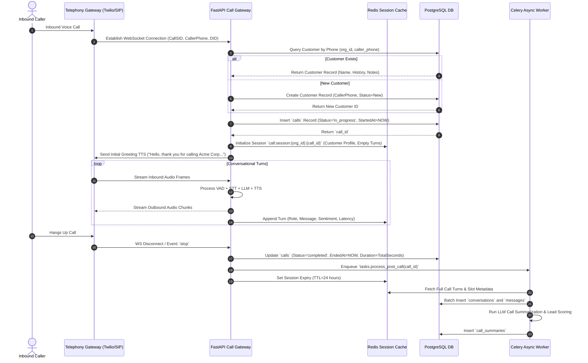
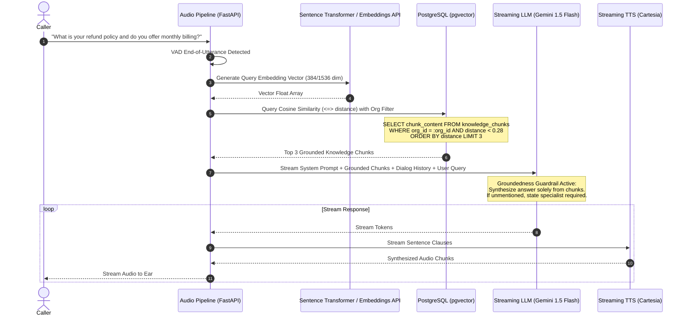
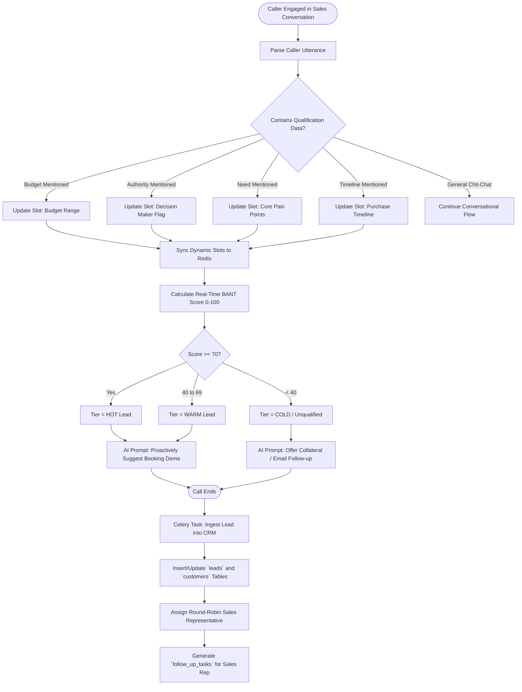
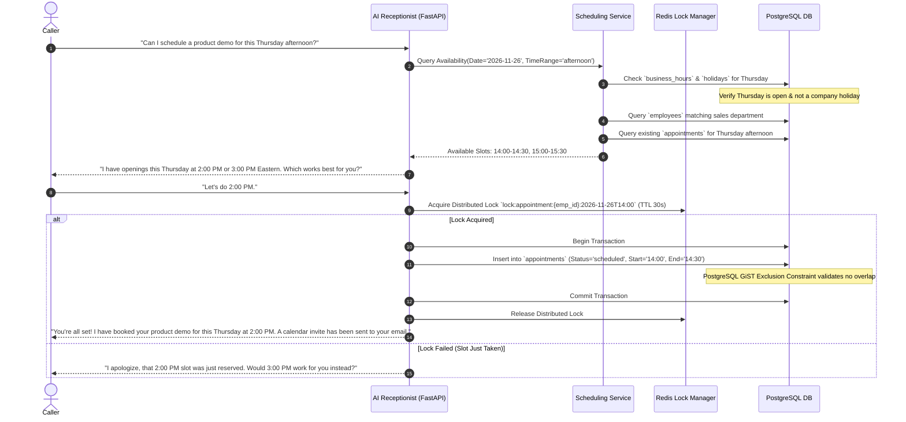
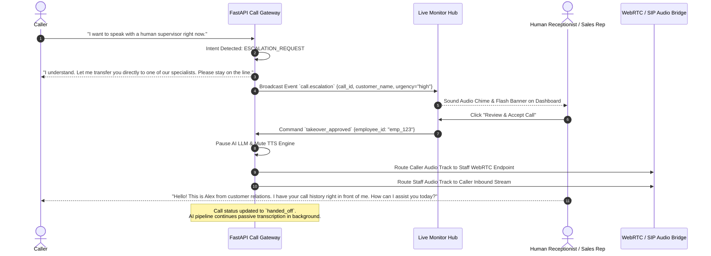
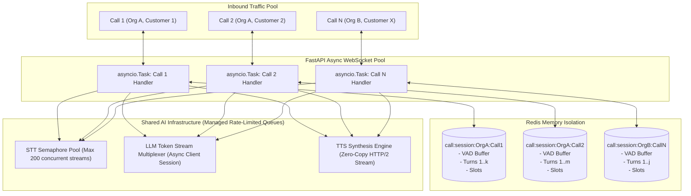
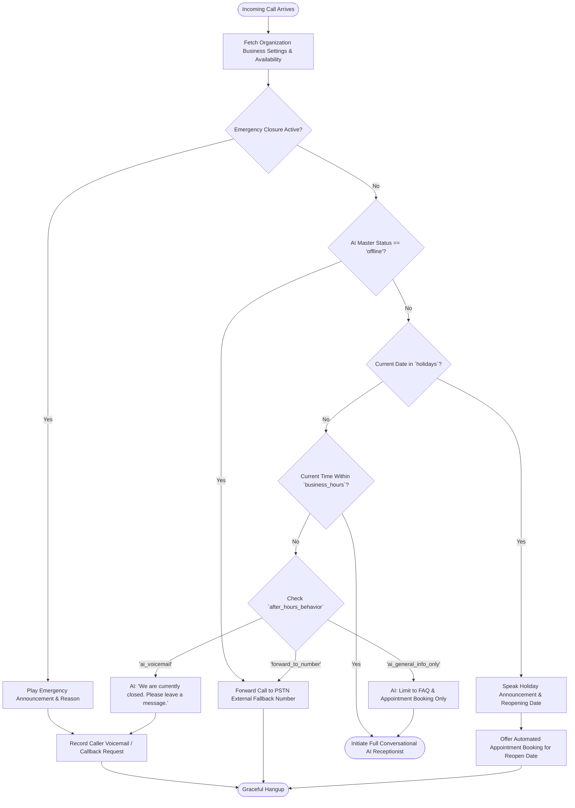

# FortiSales AI – System Workflows & Operational Sequences

This document details the seven end-to-end operational workflows governing FortiSales AI, accompanied by Mermaid sequence and flow diagrams.

---

## Workflow A: Inbound Call Lifecycle & Session Ingestion

**Scope**: Customer dials in $\to$ Customer identification $\to$ Call session instantiation $\to$ Voice conversation loop $\to$ Session finalization and transcript persistence.

---

## Workflow B: Customer Knowledge Enquiry & RAG Retrieval

**Scope**: Caller asks a complex factual question (pricing, SLA, tech specs) $\to$ Semantic retrieval $\to$ Guardrailed LLM synthesis $\to$ Audible delivery.

---

## Workflow C: Conversational Lead Qualification & CRM Extraction

**Scope**: The AI receptionist conversationally gathers customer criteria, executes scoring, updates customer records, and triggers sales notifications.

---

## Workflow D: Real-Time Appointment Scheduling & Slot Collision Guard

**Scope**: Customer requests a demo/meeting $\to$ Evaluate working hours, holidays, and employee calendars $\to$ Propose available times $\to$ Confirm with atomic database lock.

---

## Workflow E: Human Receptionist Takeover & Call Transfer

**Scope**: Caller frustration or specific request for a human $\to$ Alert staff via WebSocket $\to$ Audio bridge transition $\to$ Real-time context handover.

---

## Workflow F: Multiple Simultaneous Calls on Shared AI Infrastructure

**Scope**: High concurrency scenario $\to$ N simultaneous incoming calls $\to$ Isolated state machines $\to$ Shared connection pools and worker queues.

---

## Workflow G: Holiday & Business Closure Availability Handling

**Scope**: Incoming call arrives $\to$ System checks real-time availability rules $\to$ Routes to holiday greeting, emergency message, or customized after-hours handling.

