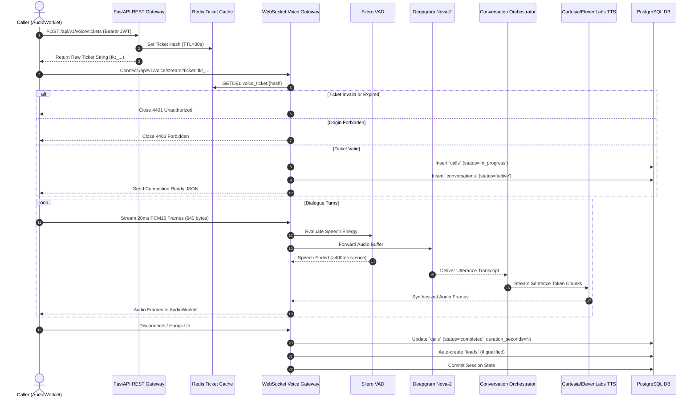
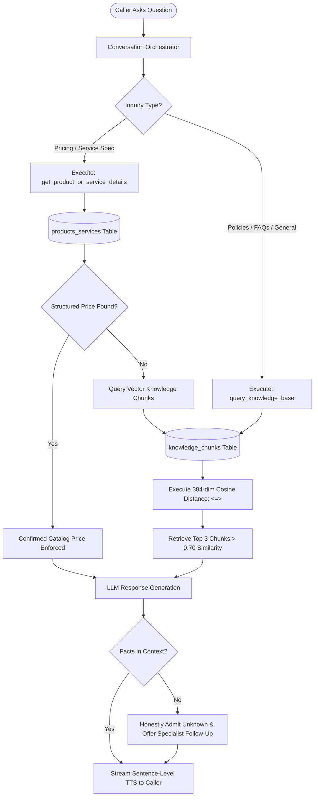
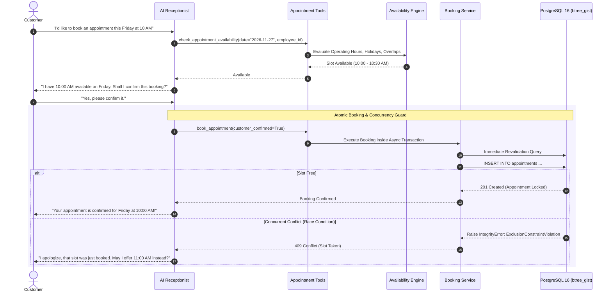
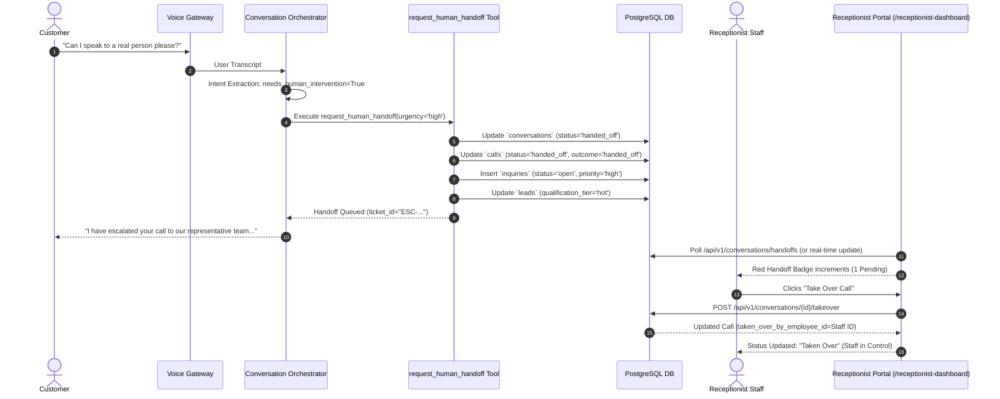
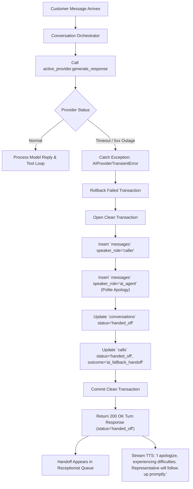

# FortiSales AI – System Workflows & Operational Sequences

This document details the core operational workflows governing FortiSales AI, accompanied by Mermaid sequence and flowchart diagrams reflecting the actual implementation.

---

## Workflow A: Inbound Voice Call Lifecycle & AudioWorklet Ingestion

**Scope**: Browser/Telephony client connects $\to$ Ephemeral ticket redemption $\to$ Full-duplex WebSocket session $\to$ VAD framing $\to$ STT $\to$ LLM $\to$ Sentence-level TTS $\to$ Call persistence.

---

## Workflow B: Customer Knowledge Inquiry & pgvector RAG Retrieval

**Scope**: Caller asks a company question (pricing, policies, services) $\to$ Semantic retrieval $\to$ Catalog precedence enforcement $\to$ Spoken response.

---

## Workflow C: Autonomous Lead Qualification, Scoring & CRM Pipeline

**Scope**: Customer dialogue turns $\to$ Turn intelligence extraction $\to$ Lead scoring (0–100) $\to$ Tiering $\to$ CRM lead creation $\to$ Sales rep isolation.

```mermaid
flowchart LR
    TurnTranscript[Spoken Dialogue Turn] --> TurnExtractor[Orchestrator Turn Intelligence]
    TurnExtractor --> BANT["Extract Budget, Authority, Need, Timeline"]
    BANT --> LeadScorer["Calculate Score (0-100)"]

    LeadScorer --> TierDecision{Score Tier}
    TierDecision -->|Score >= 70| HotTier["Hot Lead (Immediate Priority)"]
    TierDecision -->|Score 40-69| WarmTier["Warm Lead (Follow-up 24h)"]
    TierDecision -->|Score < 40| ColdTier["Cold Lead (Nurture)"]

    HotTier --> LeadInsert[Insert/Update `leads` in PostgreSQL]
    WarmTier --> LeadInsert
    ColdTier --> LeadInsert

    LeadInsert --> CallEnd{Call Concluded?}
    CallEnd -->|Yes| AdminAssign[Admin Assigns Lead to Sales Employee]
    AdminAssign --> SalesRepPortal[Sales Rep Workspace: /sales-dashboard]
    SalesRepPortal --> IsolationCheck{Cross-Rep Isolation}
    IsolationCheck -->|Assigned Rep| FullAccess[View Lead & Schedule Discovery]
    IsolationCheck -->|Other Rep| Forbidden[Access Blocked: 403 Forbidden]
```

---

## Workflow D: Conflict-Free Appointment Booking with GiST Exclusion

**Scope**: Customer requests booking $\to$ Availability check $\to$ Customer confirmation $\to$ Atomic booking protected by PostgreSQL GiST exclusion constraint.

---

## Workflow E: Live Human Handoff & Receptionist Takeover

**Scope**: Customer requests human $\to$ Tool execution $\to$ Session escalation $\to$ Real-time queue alert in receptionist portal $\to$ Staff takeover.

---

## Workflow F: Resilient AI Model Outage Fallback

**Scope**: Upstream LLM provider timeout or 5xx outage $\to$ Graceful error catch $\to$ Safe customer turn recording $\to$ Session marked handed off $\to$ Polite spoken follow-up.

